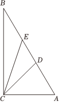
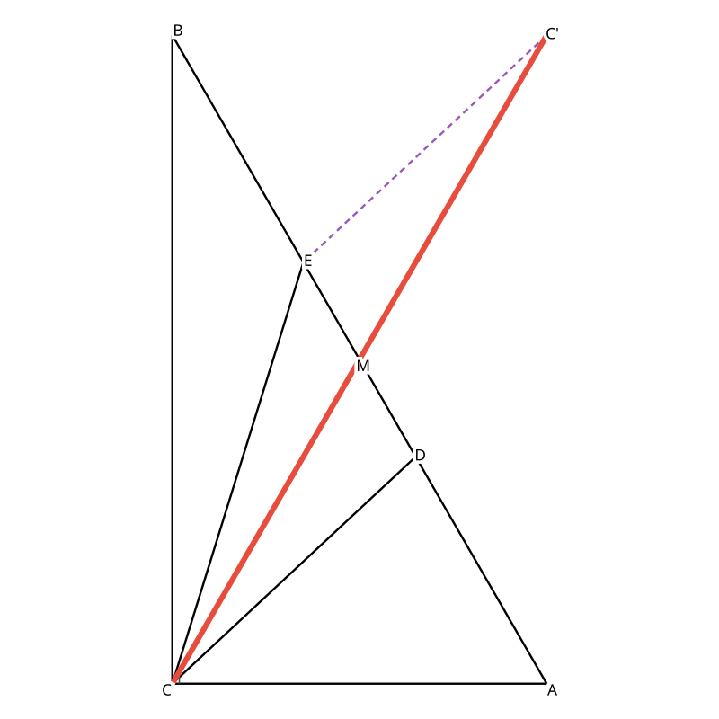

25. （2023秋•西城区校级期中）如图，$\mathrm{Rt}\triangle ABC$ 中，$\angle ACB=90^\circ$，$\angle B=30^\circ$，$D$，$E$ 为 $AB$ 边上的两个动点，且 $AD=BE$，连接 $CD$，$CE$，若 $AC=8$，则 $CD+CE$ 的最小值为 ___ 。

> [!question]- 点击查看答案与解析
> 【答案】$16$
>
> 【考点】直角三角形斜边中线、中心对称转化、最短路线、30° 直角三角形 → [[【初中数学知识点体系-人教版】#13-2 与三角形有关的线段]]、[[【初中数学知识点体系-人教版】#21-1 平行四边形]]、[[【初中数学知识点体系-人教版】#15-3 等腰三角形]]
>
> 【解析】
> $\angle ACB=90^\circ$，$\angle B=30^\circ$，$AC=8\Rightarrow AB=2AC=16$。
> 取 $AB$ 中点 $M$，作 $C$ 关于点 $M$ 的对称点 $C'$，连接 $C'E$、$CC'$。
> $\because AD=BE$，$AM=BM$，$\therefore DM=EM$；又 $MC=MC'$，$\angle CMD=\angle C'ME$（对顶角），
> $\therefore \triangle CMD\cong\triangle C'ME$（SAS），$\therefore CD=C'E$。
> $\therefore CD+CE=CE+EC'\ge CC'=2CM=AB=16$，当 $D$、$E$ 都与 $M$ 重合时取最小值 $16$。
> 
>
> 【易错点】$AC$ 是 $30^\circ$ 角所对的直角边，斜边 $AB=2AC$；最小值等于斜边长，与直角顶点位置无关。
