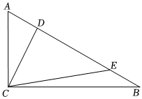
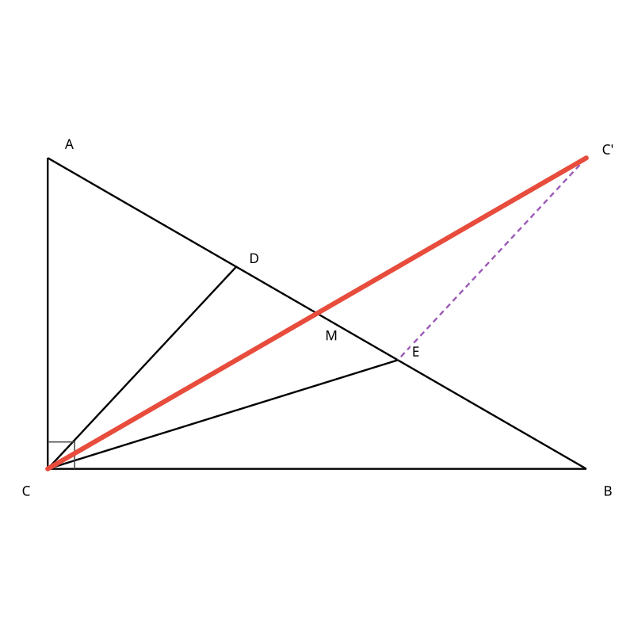

26. （2023春•汉阳区期中）如图，$\mathrm{Rt}\triangle ABC$ 中，$\angle ACB=90^\circ$，$\angle BAC=60^\circ$，$D$、$E$ 为 $AB$ 边上的两个动点（不与 $A$、$B$ 点重合），且 $AD=BE$，连接 $CD$、$CE$，若 $AC=\sqrt{3}$，则 $CD+CE$ 的最小值为 ___ 。

> [!question]- 点击查看答案与解析
> 【答案】$2\sqrt{3}$
>
> 【考点】直角三角形斜边中线、中心对称转化、最短路线、30° 直角三角形 → [[【初中数学知识点体系-人教版】#13-2 与三角形有关的线段]]、[[【初中数学知识点体系-人教版】#21-1 平行四边形]]、[[【初中数学知识点体系-人教版】#15-3 等腰三角形]]
>
> 【解析】
> $\angle ACB=90^\circ$，$\angle BAC=60^\circ\Rightarrow \angle B=30^\circ$，$AC=\sqrt{3}\Rightarrow AB=2AC=2\sqrt{3}$。
> 取 $AB$ 中点 $M$，作 $C$ 关于点 $M$ 的对称点 $C'$。
> $\because AD=BE$，$\therefore DM=EM$，又 $MC=MC'$，对顶角相等，$\therefore \triangle CMD\cong\triangle C'ME$，$\therefore CD=C'E$。
> $\therefore CD+CE=CE+EC'\ge CC'=2CM=AB=2\sqrt{3}$。
> 取等时 $D$、$E$ 都与中点 $M$ 重合，$M$ 不与 $A$、$B$ 重合，满足题目限制，$\therefore$ 最小值 $2\sqrt{3}$。
> 
>
> 【易错点】题目要求 $D$、$E$ 不与 $A$、$B$ 重合，但取等位置是中点 $M$，不受影响；若误以为端点取等会错判无最小值。
