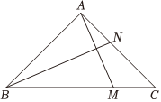
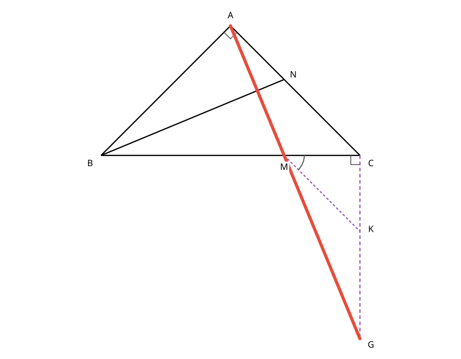

27. （2025•海珠区校级二模）如图，在等腰直角三角形 $ABC$ 中，$\angle BAC=90^\circ$，点 $M$，$N$ 分别为 $BC$，$AC$ 上的动点，且 $AN=CM$，$AB=2$。当 $AM+BN$ 的值最小时，$CM$ 的长为 ___ 。

> [!question]- 点击查看答案与解析
> 【答案】$2\sqrt{2}-2$
>
> 【考点】等腰直角三角形的性质、全等三角形与最短路线、22.5° 角的转化 → [[【初中数学知识点体系-人教版】#15-3 等腰三角形]]、[[【初中数学知识点体系-人教版】#14-2 三角形全等的判定]]、[[【初中数学知识点体系-人教版】#20-1 勾股定理]]
>
> 【解析】
> $\angle BAC=90^\circ$，$AB=AC=2$，$\therefore BC=2\sqrt{2}$，$\angle ABC=\angle ACB=45^\circ$。
> 在 $BC$ 下方（$A$ 的异侧）作 $\angle MCG=90^\circ$，截取 $CG=AB=2$，连接 $MG$、$AG$。
> $\because CM=AN$，$\angle MCG=\angle NAB=90^\circ$，$CG=AB$，$\therefore \triangle MCG\cong\triangle NAB$（SAS），$\therefore MG=NB$。
> $\therefore AM+BN=AM+MG\ge AG$，当 $A$、$M$、$G$ 三点共线时取最小值。
> 此时 $\angle ACG=\angle ACB+\angle BCG=45^\circ+90^\circ=135^\circ$，$CA=CG=2$，
> $\therefore \angle CAG=\angle CGA=\dfrac{180^\circ-135^\circ}{2}=22.5^\circ$。
> 在 $\mathrm{Rt}\triangle GCM$ 中（$\angle GCM=90^\circ$，$M$ 在 $AG$ 上），$\angle CGM=22.5^\circ$，$\angle GMC=67.5^\circ$。
> 在 $GC$ 上取点 $K$，使 $\angle KMC=45^\circ$，则 $\triangle KCM$ 为等腰直角三角形，$KC=CM$，$MK=\sqrt{2}CM$；
> $\angle KMG=\angle GMC-\angle KMC=67.5^\circ-45^\circ=22.5^\circ=\angle KGM$，$\therefore KG=MK=\sqrt{2}CM$。
> $\therefore CG=CK+KG=CM+\sqrt{2}CM=(1+\sqrt{2})CM=2$，
> $\therefore CM=\dfrac{2}{1+\sqrt{2}}=2(\sqrt{2}-1)=2\sqrt{2}-2$。
> 
>
> 【易错点】全等对应边是 $MG=NB$（$M\leftrightarrow N$、$G\leftrightarrow B$）；求 $CM$ 时出现 $22.5^\circ$，用"构造 $45^\circ$ 等腰直角三角形 + 等角对等边"把 $CG$ 拆成 $(1+\sqrt{2})CM$，不要直接用三角函数。
