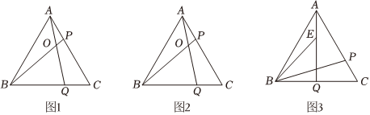
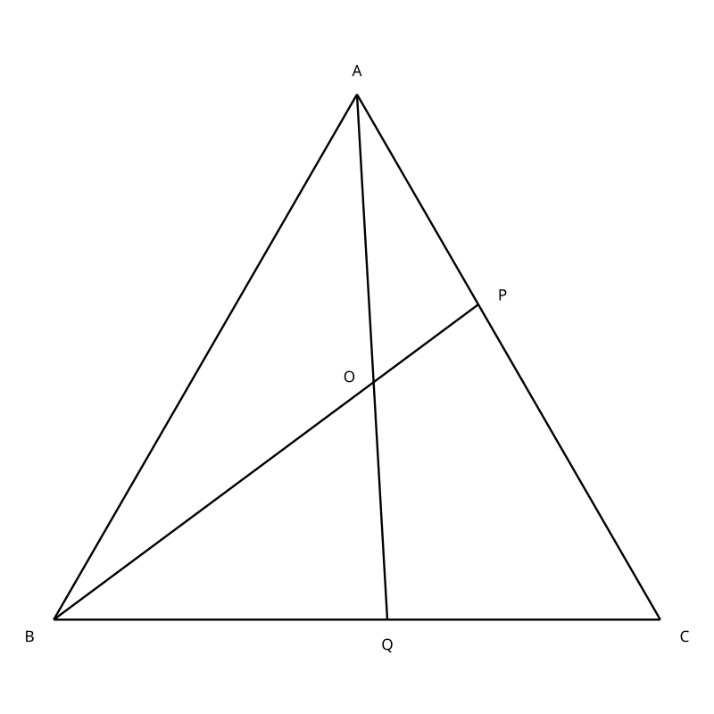
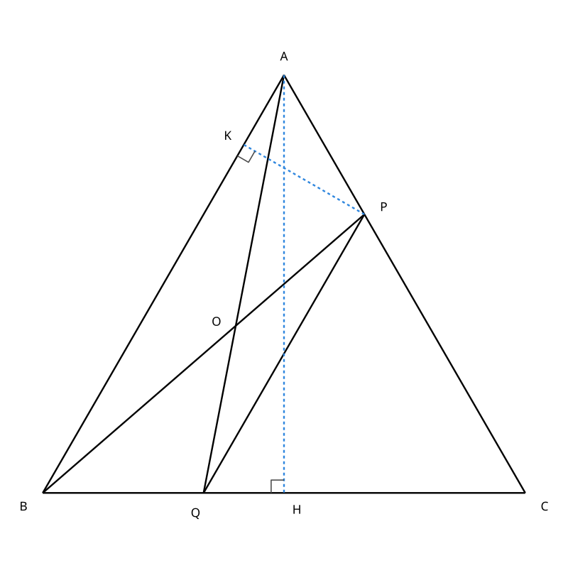
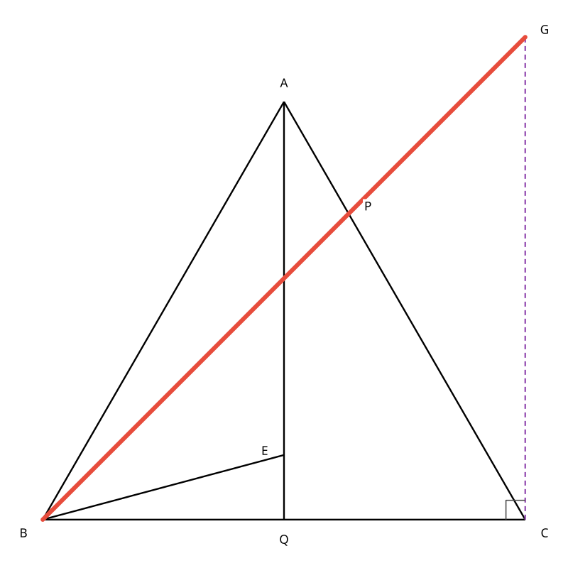

28. （2025秋•洪雅县期末）已知 $\triangle ABC$ 是等边三角形，

（1）如图 1，在线段 $AC$、$BC$ 上各取一点 $P$、$Q$，$AQ$、$BP$ 相交于点 $O$，若 $\angle BOQ=60^\circ$，求证：$AP=CQ$；

（2）如图 2，在线段 $AC$ 上取一点 $P$ 使得 $AP=\frac{1}{3}AC$，在线段 $BC$ 上有一个动点 $Q$，$AQ$、$BP$ 相交于点 $O$，连接 $PQ$，若 $AQ=BP$，求 $\frac{S_{\triangle CPQ}}{S_{\triangle ABC}}$ 的值；

（3）如图 3，若 $AQ$ 是等边 $\triangle ABC$ 的中线，点 $E$、$P$ 分别是线段 $AQ$、$AC$ 上的动点，且 $AE=CP$，当 $BE+BP$ 取得最小值时，求 $\angle EBP$ 的度数。

> [!question]- 点击查看答案与解析
> 【答案】（1）见解析；（2）$\dfrac{4}{9}$ 或 $\dfrac{2}{9}$；（3）$30^\circ$
>
> 【考点】等边三角形的性质、全等三角形的判定与性质、面积比、最短路线 → [[【初中数学知识点体系-人教版】#15-3 等腰三角形]]、[[【初中数学知识点体系-人教版】#14-2 三角形全等的判定]]、[[【初中数学知识点体系-人教版】#13-3 三角形的内角与外角]]
>
> 【解析】
> （1）$\angle BOQ$ 是 $\triangle ABO$ 的外角，$\therefore \angle BOQ=\angle BAQ+\angle ABP=60^\circ$。
> 又 $\angle ABP+\angle PBC=\angle ABC=60^\circ$，$\therefore \angle BAQ=\angle PBC$，即 $\angle BAQ=\angle CBP$。
> 在 $\triangle ABQ$ 与 $\triangle BCP$ 中：$\angle BAQ=\angle CBP$，$AB=BC$，$\angle ABQ=\angle BCP=60^\circ$，
> $\therefore \triangle ABQ\cong\triangle BCP$（ASA），$\therefore BQ=CP$。
> $\therefore AP=AC-CP=BC-BQ=CQ$。
> （2）设等边三角形边长为 $3$，则 $AP=1$，$CP=2$。过 $P$ 作 $PK\perp AB$ 于 $K$，$\angle A=60^\circ\Rightarrow AK=\dfrac12$，$PK=\dfrac{\sqrt{3}}{2}$，$BK=\dfrac52$，
> $\therefore BP=\sqrt{BK^2+PK^2}=\sqrt{7}$，$\therefore AQ=\sqrt{7}$。
> 过 $A$ 作 $AH\perp BC$ 于 $H$（$H$ 为 $BC$ 中点），$BH=\dfrac32$，$AH=\dfrac{3\sqrt{3}}{2}$。设 $BQ=x$，则
> $AQ^2=AH^2+QH^2=\dfrac{27}{4}+\left(x-\dfrac32\right)^2=7\Rightarrow \left(x-\dfrac32\right)^2=\dfrac14\Rightarrow x=1$ 或 $x=2$。
> $\therefore CQ=2$ 或 $CQ=1$（两解都满足 $Q$ 在边 $BC$ 上）。
> $\triangle CPQ$ 与 $\triangle CPB$ 同高（自 $P$ 向 $BC$），$\dfrac{S_{\triangle CPQ}}{S_{\triangle CPB}}=\dfrac{CQ}{CB}$；$\triangle CPB$ 与 $\triangle ABC$ 同高（自 $B$ 向 $AC$），$\dfrac{S_{\triangle CPB}}{S_{\triangle ABC}}=\dfrac{CP}{CA}=\dfrac23$。
> $\therefore \dfrac{S_{\triangle CPQ}}{S_{\triangle ABC}}=\dfrac{CQ}{3}\times\dfrac23$：$CQ=2$ 时为 $\dfrac49$；$CQ=1$ 时为 $\dfrac29$。
> （3）$AQ$ 是等边三角形的中线，即 $BC$ 边上的高，$\angle BAQ=\angle CAQ=30^\circ$。
> 在 $AC$ 右侧（$B$ 的异侧）作 $\angle PCG=30^\circ$，截取 $CG=AB$，连接 $PG$、$BG$。
> $\because AE=CP$，$\angle EAB=\angle PCG=30^\circ$，$AB=CG$，$\therefore \triangle EAB\cong\triangle PCG$（SAS），$\therefore BE=GP$。
> $\therefore BE+BP=GP+PB\ge BG$，当 $B$、$P$、$G$ 三点共线时取最小值。
> 此时 $\angle BCG=\angle BCA+\angle ACG=90^\circ$，$CG=AB=BC$，$\triangle BCG$ 等腰直角，$\angle GBC=\angle BGC=45^\circ$，即 $\angle PBC=45^\circ$。
> 由全等 $\angle ABE=\angle CGP=\angle CGB=45^\circ$，$\therefore \angle EBC=60^\circ-45^\circ=15^\circ$，
> $\therefore \angle EBP=\angle PBC-\angle EBC=45^\circ-15^\circ=30^\circ$。
> 
> 
> 
>
> 【易错点】第（2）问 $AQ=BP$ 给出关于 $BQ$ 的二次方程，有两解，面积比必须写两个值；第（3）问构造点记为 $G$，避免与动点 $E$ 混淆，对应边为 $BE=GP$。
