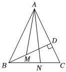
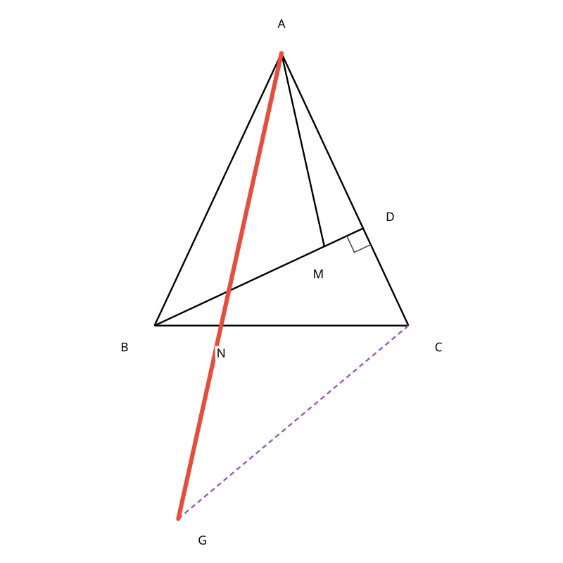

29. （2025秋•河西区校级月考）如图，在 $\triangle ABC$ 中，$\angle BAC=50^\circ$，$AB=AC$，$BD\perp AC$ 于点 $D$，$M$，$N$ 分别是线段 $BD$，$BC$ 上的动点，$BM=CN$，当 $AM+AN$ 最小时，$\angle MAD$ 的度数为（　　）

A. $12.5^\circ$

B. $15^\circ$

C. $17.5^\circ$

D. $30^\circ$

> [!question]- 点击查看答案与解析
> 【答案】A
>
> 【考点】等腰三角形的性质、全等三角形与最短路线、三角形内角和 → [[【初中数学知识点体系-人教版】#15-3 等腰三角形]]、[[【初中数学知识点体系-人教版】#14-2 三角形全等的判定]]、[[【初中数学知识点体系-人教版】#13-3 三角形的内角与外角]]
>
> 【解析】
> $\angle BAC=50^\circ$，$AB=AC\Rightarrow \angle ABC=\angle ACB=65^\circ$。$BD\perp AC\Rightarrow \angle ABD=40^\circ$，$\angle DBC=25^\circ$。
> 在 $BC$ 下方（$A$ 的异侧）作 $\angle NCG=\angle MBA=40^\circ$，截取 $CG=BA$，连接 $NG$、$AG$。
> $\because BM=CN$，$\angle MBA=\angle NCG$，$BA=CG$，$\therefore \triangle MBA\cong\triangle NCG$（SAS），$\therefore AM=GN$。
> $\therefore AM+AN=AN+NG\ge AG$，当 $A$、$N$、$G$ 三点共线时取最小值。
> $\because CA=CG$（$CG=BA=CA$），$\angle ACG=\angle ACB+\angle BCG=65^\circ+40^\circ=105^\circ$，
> $\therefore \angle CAG=\angle CGA=\dfrac{180^\circ-105^\circ}{2}=37.5^\circ$。
> 由全等得 $\angle BAM=\angle CGN=\angle CGA=37.5^\circ$，
> $\therefore \angle MAD=\angle BAD-\angle BAM=50^\circ-37.5^\circ=12.5^\circ$，故选 A。
> 
>
> 【易错点】$\angle MBA=\angle ABD=40^\circ$（$M$ 在 $BD$ 上），不是 $25^\circ$ 的 $\angle DBC$；$\angle MAD$ 要用 $\angle BAD=50^\circ$ 减去 $\angle BAM$。
