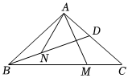
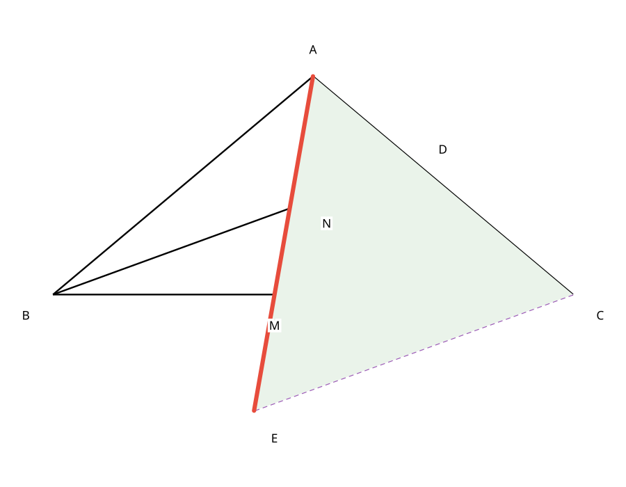

30. （2024•乐山模拟）如图，等腰 $\triangle ABC$ 中，$\angle BAC=100^\circ$，$BD$ 平分 $\angle ABC$，点 $N$ 为 $BD$ 上一点，点 $M$ 为 $BC$ 上一点，且 $BN=MC$，若当 $AM+AN$ 的最小值为 4 时，$AB$ 的长度是 ___ 。

> [!question]- 点击查看答案与解析
> 【答案】$4$
>
> 【考点】等腰三角形的性质、角平分线、全等三角形与最短路线（逆等线模型） → [[【初中数学知识点体系-人教版】#15-3 等腰三角形]]、[[【初中数学知识点体系-人教版】#14-2 三角形全等的判定]]、[[【初中数学知识点体系-人教版】#13-3 三角形的内角与外角]]
>
> 【解析】
> $\angle BAC=100^\circ$，$AB=AC\Rightarrow \angle ABC=\angle ACB=40^\circ$，$BD$ 平分 $\angle ABC\Rightarrow \angle ABD=\angle DBC=20^\circ$。
> 在 $BC$ 下方（$A$ 的异侧）作 $\angle MCE=20^\circ$，截取 $CE=BA$，连接 $ME$、$AE$。
> $\because BN=MC$，$\angle NBA=\angle MCE=20^\circ$，$BA=CE$，$\therefore \triangle NBA\cong\triangle MCE$（SAS），$\therefore AN=EM$。
> $\therefore AM+AN=AM+ME\ge AE$，当 $A$、$M$、$E$ 三点共线时取最小值。
> $\because \angle ACE=\angle ACB+\angle BCE=40^\circ+20^\circ=60^\circ$，$CA=CE$（$=AB$），
> $\therefore \triangle ACE$ 为等边三角形，$AE=AC=AB$。
> $\therefore (AM+AN)_{\min}=AB=4$。
> 
>
> 【易错点】$100^\circ$ 等腰 + 角平分线模型的最小值恰为腰长 $AB$（构造后出现等边三角形），不要误算成底边或高。
