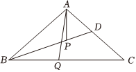
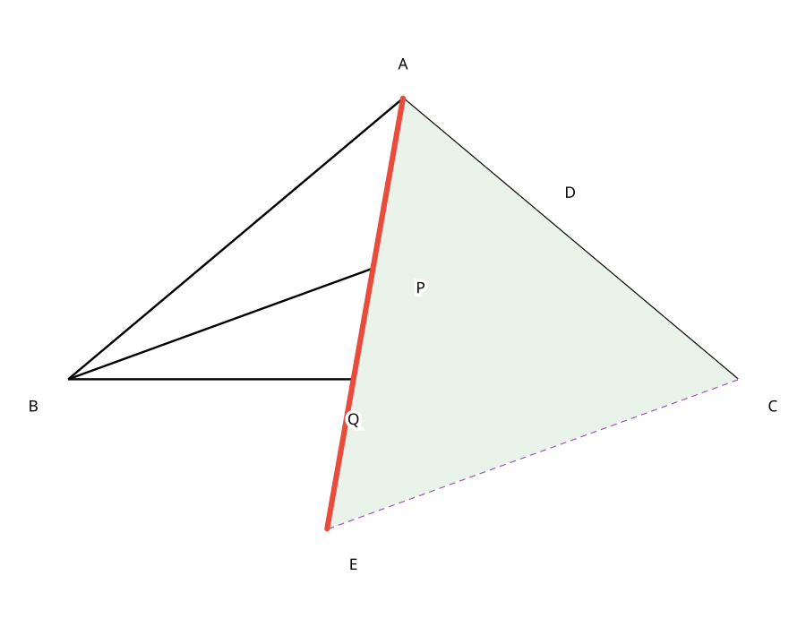

31. （2024•合肥模拟）如图，在 $\triangle ABC$ 中，$AB=AC$，$\angle BAC=100^\circ$，$BD$ 平分 $\angle ABC$，$P$，$Q$ 分别为边 $BD$，$BC$ 上一点，且 $BP=CQ$，若当 $AP+AQ$ 的最小值为 5 时，则 $AB$ 的长为（　　）

A. $4$

B. $\frac{9}{2}$

C. $5$

D. $6$

> [!question]- 点击查看答案与解析
> 【答案】C
>
> 【考点】等腰三角形的性质、角平分线、全等三角形与最短路线（逆等线模型） → [[【初中数学知识点体系-人教版】#15-3 等腰三角形]]、[[【初中数学知识点体系-人教版】#14-2 三角形全等的判定]]、[[【初中数学知识点体系-人教版】#13-3 三角形的内角与外角]]
>
> 【解析】
> $\angle BAC=100^\circ$，$AB=AC\Rightarrow \angle ABC=\angle ACB=40^\circ$，$BD$ 平分 $\angle ABC\Rightarrow \angle ABD=\angle DBC=20^\circ$。
> 在 $BC$ 下方作 $\angle QCE=20^\circ$，截取 $CE=BA$，连接 $QE$、$AE$。
> $\because BP=CQ$，$\angle PBA=\angle QCE=20^\circ$，$BA=CE$，$\therefore \triangle PBA\cong\triangle QCE$（SAS），$\therefore AP=EQ$。
> $\therefore AP+AQ=EQ+QA\ge AE$，当 $A$、$Q$、$E$ 共线时取最小值。
> $\angle ACE=\angle ACB+\angle BCE=60^\circ$，$CA=CE\Rightarrow \triangle ACE$ 等边，$AE=AB$。
> $\therefore (AP+AQ)_{\min}=AB=5$，故选 C。
> 
>
> 【易错点】与第 30 题同模型：最小值 = 腰长 $AB$；选项中 $4$、$\dfrac92$、$6$ 均为干扰项。
