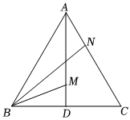
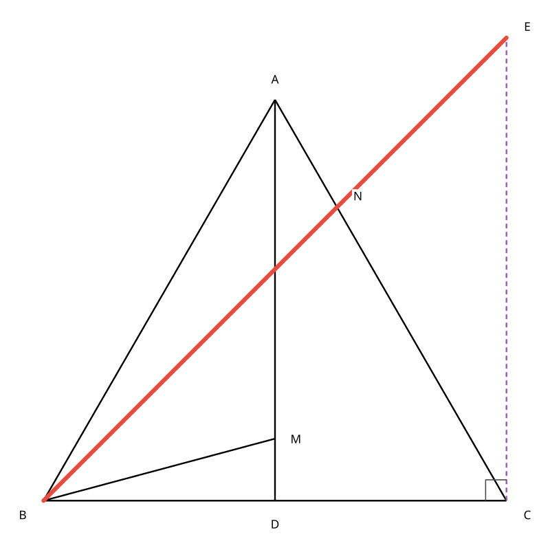

32. （2024秋•武安市期末）如图，等边 $\triangle ABC$ 中，$AD$ 为 $BC$ 边上的高，点 $M$、$N$ 分别在 $AD$、$AC$ 上，且 $AM=CN$，连 $BM$、$BN$，当 $BM+BN$ 最小时，$\angle BNC=$ ___ 。

> [!question]- 点击查看答案与解析
> 【答案】$75^\circ$
>
> 【考点】等边三角形的性质、全等三角形与最短路线、三角形内角和 → [[【初中数学知识点体系-人教版】#15-3 等腰三角形]]、[[【初中数学知识点体系-人教版】#14-2 三角形全等的判定]]、[[【初中数学知识点体系-人教版】#15-1 图形的轴对称]]
>
> 【解析】
> 在 $AC$ 右侧（$B$ 的异侧）作 $\angle ACE=30^\circ$，截取 $CE=AB$，连接 $NE$、$BE$。
> $\because AM=CN$，$\angle MAB=\angle NCE=30^\circ$，$AB=CE$，$\therefore \triangle MAB\cong\triangle NCE$（SAS），$\therefore BM=EN$。
> $\therefore BM+BN=EN+NB\ge BE$，当 $B$、$N$、$E$ 三点共线时取最小值。
> 此时 $\angle BCE=\angle BCA+\angle ACE=90^\circ$，$CE=AB=BC$，$\triangle BCE$ 为等腰直角三角形，$\angle NBC=\angle EBC=45^\circ$。
> 在 $\triangle BNC$ 中，$\angle BNC=180^\circ-\angle NBC-\angle NCB=180^\circ-45^\circ-60^\circ=75^\circ$。
> 
>
> 【易错点】$\angle BNC$ 是 $\triangle BNC$ 的内角（$75^\circ$），不要与共线补角 $\angle ENC=105^\circ$ 混淆。
