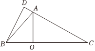
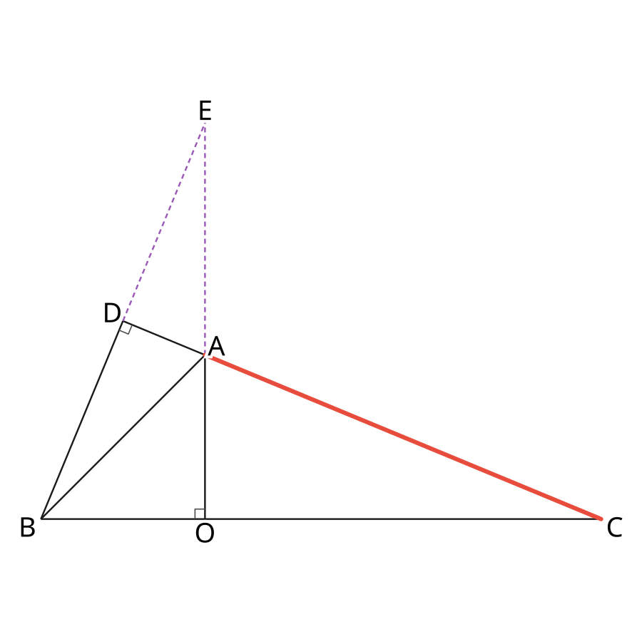

1. （2024秋•银州区校级月考）如图，在 Rt△$OAB$ 中，$OA=OB$，$\angle AOB=90^\circ$，点 $C$ 在边 $BO$ 延长线上一点，过点 $B$ 作 $BD\perp CA$ 交 $CA$ 的延长线于点 $D$，若 $\angle OAC=\angle BAD$，则 $\frac{AC}{BD}=$（　　）

A. $\frac{3}{2}$

B. $2$

C. $\frac{7}{4}$

D. $\frac{5}{2}$

> [!question]- 点击查看答案与解析
> 【答案】B
>
> 【考点】等腰直角三角形的性质、全等三角形的判定与性质、三角形内角和 → [[【初中数学知识点体系-人教版】#15-3 等腰三角形]]、[[【初中数学知识点体系-人教版】#14-2 三角形全等的判定]]、[[【初中数学知识点体系-人教版】#13-3 三角形的内角与外角]]
>
> 【解析】
> - 由 $OA=OB$，$\angle AOB=90^\circ$，$\triangle OAB$ 为等腰直角三角形，$\angle OAB=\angle OBA=45^\circ$。
> - 设 $\angle OAC=\angle BAD=\alpha$。因 $D$、$A$、$C$ 共线，$AD$ 与 $AC$ 互为反向延长线；在点 $A$ 处由平角与 $\angle OAB=45^\circ$ 得 $\angle BAD=180^\circ-45^\circ-\alpha=135^\circ-\alpha$，结合 $\angle BAD=\alpha$，得 $\alpha=67.5^\circ$。
> - 延长 $BD$ 与 $OA$ 交于点 $E$。因射线 $AE$ 与射线 $AO$ 互为反向延长线，得 $\angle EAD=180^\circ-\angle OAB-\angle BAD=180^\circ-45^\circ-67.5^\circ=67.5^\circ=\angle BAD$；又 $AD=AD$，$\angle ADB=\angle ADE=90^\circ$，故 $\triangle ABD\cong\triangle AED$（ASA），得 $BD=ED$，即 $BE=2BD$。
> - 由 $\angle ABD=90^\circ-\angle BAD=22.5^\circ$，得 $\angle EBO=\angle ABD+\angle ABO=22.5^\circ+45^\circ=67.5^\circ=\angle CAO$；又 $OB=OA$，$\angle BOE=\angle AOC=90^\circ$，故 $\triangle BOE\cong\triangle AOC$（ASA），得 $AC=BE=2BD$，故 $\frac{AC}{BD}=2$。
> - 选项 A $\frac{3}{2}$、C $\frac{7}{4}$、D $\frac{5}{2}$ 均与推导不符。
> 
>
> 【易错点】误把 $D$ 当作 $AC$ 上的点（实为 $CA$ 延长线上的垂足）；忽略 $AD$ 与 $AC$ 反向共线，导致角的等量关系列错。
