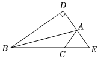
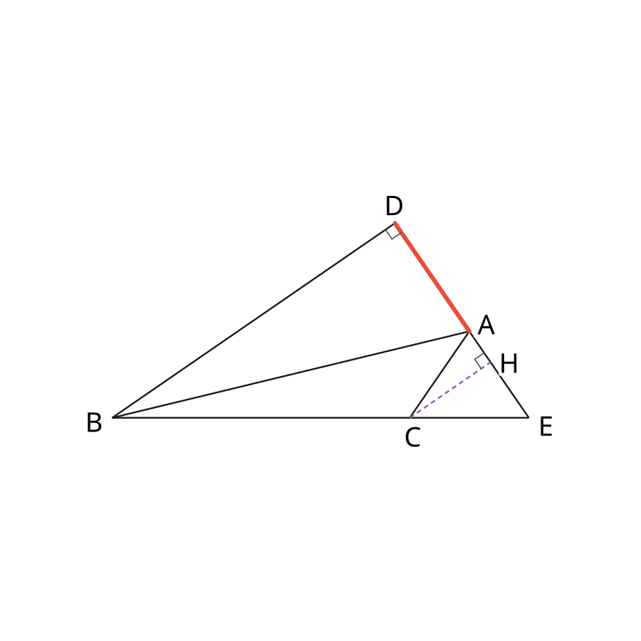

2. （2024秋•徐汇区校级期中）如图，$\triangle ACE$ 中，$AC=AE$，$BD\perp AE$ 交 $EA$ 的延长线于点 $D$，若 $\angle BAD=\angle CAE$，$AE=2$，$AB=7$，则 $AD$ 的长为 ___ 。

> [!question]- 点击查看答案与解析
> 【答案】$2.5$
>
> 【考点】等腰三角形的性质、相似三角形的判定与性质 → [[【初中数学知识点体系-人教版】#15-3 等腰三角形]]、[[【初中数学知识点体系-人教版】#31-2 相似三角形]]
>
> 【解析】
> - 由 $AC=AE$，$AE=2$ 得 $AC=2$；由图可知 $B$、$C$、$E$ 共线（$B$ 在 $EC$ 的延长线上），$D$、$A$、$E$ 共线（$D$ 在 $EA$ 的延长线上）。过点 $C$ 作 $CH\perp DE$ 于点 $H$（见解题配图），因 $BD\perp DE$，故 $CH\parallel BD$。
> - 在 $\triangle AHC$ 与 $\triangle ADB$ 中，$\angle AHC=\angle ADB=90^\circ$，$\angle HAC=\angle CAE=\angle BAD$，故 $\triangle AHC\sim\triangle ADB$，得 $\frac{AH}{AD}=\frac{CH}{BD}=\frac{AC}{AB}=\frac{2}{7}$。
> - 由 $CH\parallel BD$ 得 $\triangle EHC\sim\triangle EDB$，故 $\frac{EH}{ED}=\frac{CH}{BD}=\frac{2}{7}$。
> - 于是 $AH=\frac{2}{7}AD$，$EH=\frac{2}{7}ED$。又 $ED=EA+AD=AD+2$，且 $H$ 在线段 $AE$ 上，$AE=AH+EH$，代入得 $\frac{2}{7}AD+\frac{2}{7}(AD+2)=2$。
> - 解得 $2AD+2=7$，即 $AD=\frac{5}{2}=2.5$。
> 
>
> 【易错点】忽略图中 $B$、$C$、$E$ 共线与 $D$、$A$、$E$ 共线，想不到过 $C$ 向 $DE$ 作垂线构造"镜面角"的相似结构；或把 $ED$ 错写成 $AD-AE$（应为 $AD+AE$）。
