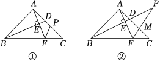
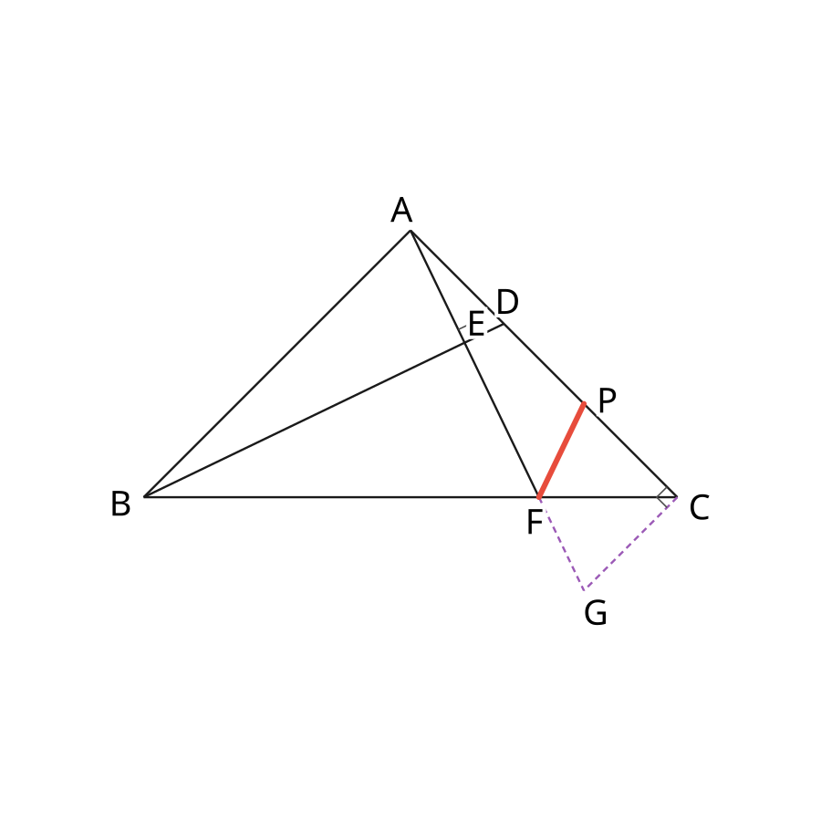
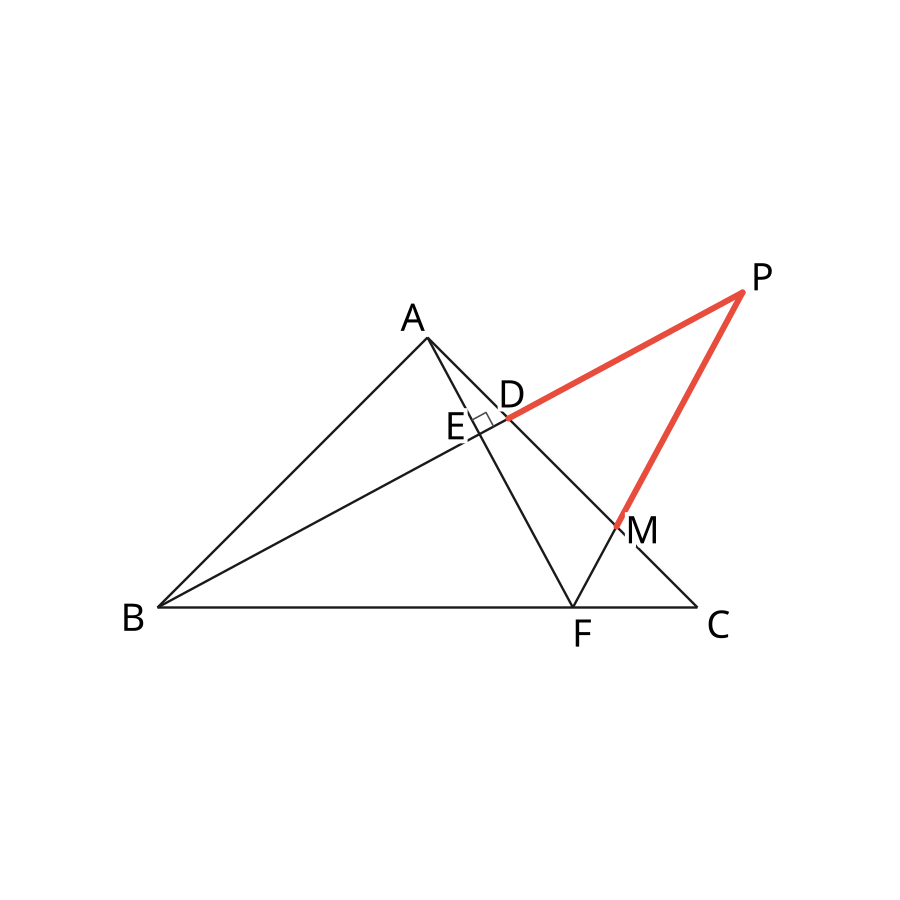

3. （2026秋•单元）在 $\triangle ABC$ 中，$AB=AC$，$\angle BAC=90^\circ$，点 $D$ 是 $AC$ 上一点，连接 $BD$，过点 $A$ 作 $AE\perp BD$ 于 $E$，交 $BC$ 于 $F$。

（1）如图 $①$，若点 $P$ 是 $AC$ 上一点，连接 $FP$，$AP=CD$，求证：$\angle ADB=\angle CPF$；

（2）如图 $②$，若点 $M$ 在 $AC$ 上，$AD=CM$，延长 $BD$ 交直线 $FM$ 于 $P$，求证：$PD=PM$。

> [!question]- 点击查看答案与解析
> 【答案】（1）（2）均为证明题，推理链见解析
>
> 【考点】等腰三角形的性质（等腰直角三角形）、全等三角形的判定与性质（ASA、SAS）、直角三角形两锐角互余 → [[【初中数学知识点体系-人教版】#15-3 等腰三角形]]、[[【初中数学知识点体系-人教版】#14-2 三角形全等的判定]]、[[【初中数学知识点体系-人教版】#13-3 三角形的内角与外角]]
>
> 【解析】
> （1）如图 $①$，求证 $\angle ADB=\angle CPF$：
> - 由 $AB=AC$，$\angle BAC=90^\circ$，知 $\triangle ABC$ 为等腰直角三角形，$\angle ACB=45^\circ$。
> - 在 Rt$\triangle ABD$ 中（$\angle BAD=\angle BAC=90^\circ$），$\angle ABD+\angle ADB=90^\circ$；因 $AE\perp BD$，在 Rt$\triangle AED$ 中 $\angle EAD+\angle ADE=90^\circ$。而 $\angle ADB$ 与 $\angle ADE$ 是同一个角，故 $\angle CAF=\angle EAD=\angle ABD$。
> - 过点 $C$ 作 $CG\perp AC$ 交 $AF$ 的延长线于点 $G$（见解题配图）。则 $\angle ACG=90^\circ=\angle BAD$；又 $AC=BA$，$\angle CAG=\angle CAF=\angle ABD$，故 $\triangle ACG\cong\triangle BAD$（ASA），得 $CG=AD$，$\angle AGC=\angle BDA$。
> - 由 $AP=CD$，得 $PC=AC-AP=AC-CD=AD=CG$。
> - 又 $\angle PCF=\angle ACB=45^\circ$，$\angle GCF=\angle ACG-\angle ACF=90^\circ-45^\circ=45^\circ=\angle PCF$；且 $CF=CF$，$CP=CG$，故 $\triangle PCF\cong\triangle GCF$（SAS），得 $\angle CPF=\angle CGF=\angle CGA=\angle ADB$。证毕。
>
> （2）如图 $②$，求证 $PD=PM$：
> - 由 $AD=CM$，得 $AM=AC-CM=AC-AD=CD$，即点 $M$ 满足第（1）问中点 $P$ 的条件"$AM=CD$"，故由（1）的结论得 $\angle CMF=\angle ADB$。
> - 因 $P$ 在 $BD$ 的延长线上、$M$ 在 $DC$ 上，$\angle PDM$ 与 $\angle BDC$ 互补（射线 $DP$ 与射线 $DB$ 反向，射线 $DM$ 即射线 $DC$），而 $\angle ADB$ 与 $\angle BDC$ 也互补，故 $\angle PDM=\angle ADB$。
> - 射线 $MP$ 与射线 $MF$ 反向、射线 $MD$ 与射线 $MC$ 反向，故 $\angle PMD=\angle FMC$（对顶角相等）$=\angle ADB$。
> - 于是 $\angle PDM=\angle PMD$，由等角对等边得 $PD=PM$。证毕。
> 
> 
>
> 【易错点】（1）中想不到过 $C$ 作 $AC$ 的垂线构造 $\triangle ACG\cong\triangle BAD$，导致 $CG=AD$ 与 $\angle CGA=\angle ADB$ 两个关键条件无法集中；（2）中看不出 $CM=AD$ 等价于 $AM=CD$（即 $M$ 就是第（1）问的点 $P$），或把 $\angle PDM$、$\angle PMD$ 的对顶/补角关系弄错。
