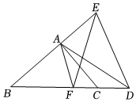
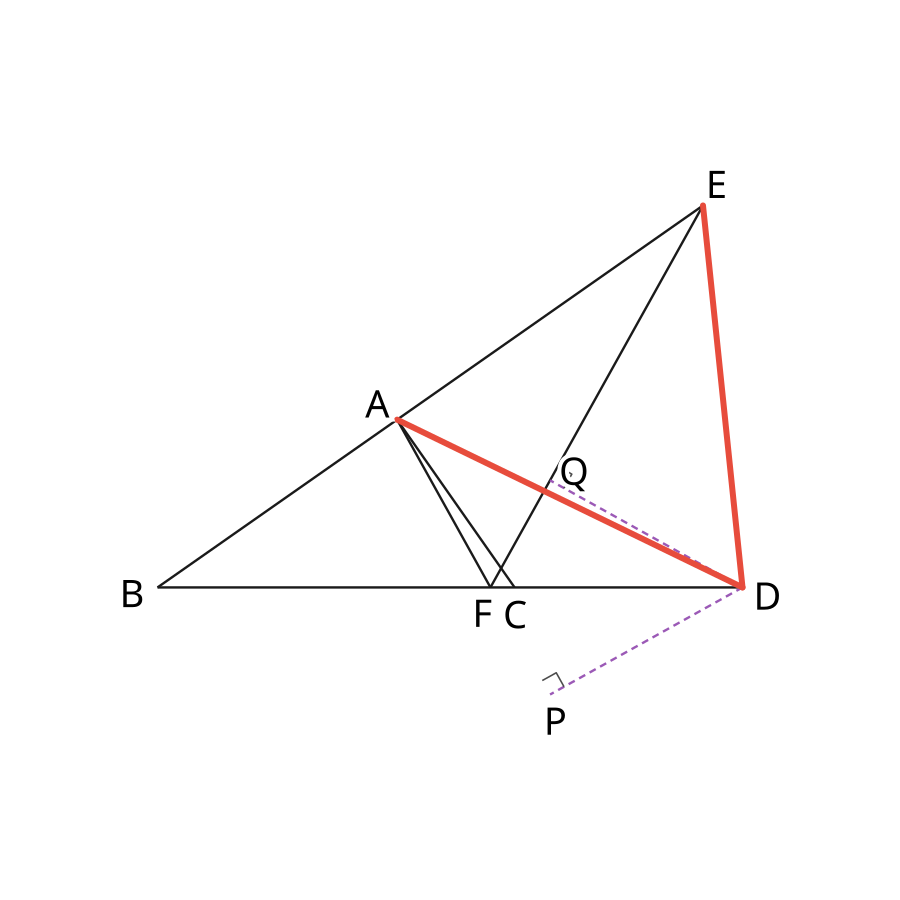

4. （2022•江汉区模拟）在 Rt△$ABC$ 中，$\angle BAC=90^\circ$，$D$，$E$ 分别在 $BC$，$BA$ 的延长线上，$\angle ADE=2\angle CAD$，$F$ 在 $BD$ 上，$\angle AFB=\angle EFD$。

（1）求证：$DA=DE$；

（2）求证：$\angle FAD=\angle FED$；

（3）若 $AB=AC$，$BF=mCF$，求 $AF$ 与 $EF$ 的数量关系。（用含 $m$ 的式子表示）

> [!question]- 点击查看答案与解析
> 【答案】（1）（2）见解析；（3）$EF=mAF$
>
> 【考点】直角三角形两锐角互余与三角形内角和、等角对等边、全等三角形的判定与性质（AAS、HL）、相似三角形的判定与性质 → [[【初中数学知识点体系-人教版】#13-3 三角形的内角与外角]]、[[【初中数学知识点体系-人教版】#14-2 三角形全等的判定]]、[[【初中数学知识点体系-人教版】#15-3 等腰三角形]]、[[【初中数学知识点体系-人教版】#31-2 相似三角形]]
>
> 【解析】
> （1）求证 $DA=DE$：
> - 因 $E$ 在 $BA$ 的延长线上且 $\angle BAC=90^\circ$，故 $\angle EAC=180^\circ-\angle BAC=90^\circ$，射线 $AD$ 在 $\angle EAC$ 内部，$\angle DAE=90^\circ-\angle CAD$。
> - 在 $\triangle ADE$ 中，$\angle AED=180^\circ-\angle ADE-\angle DAE=180^\circ-2\angle CAD-(90^\circ-\angle CAD)=90^\circ-\angle CAD=\angle DAE$。
> - 由等角对等边得 $DA=DE$。证毕。
>
> （2）求证 $\angle FAD=\angle FED$：
> - 过点 $D$ 作 $DP\perp AF$ 交 $AF$ 的延长线于点 $P$，作 $DQ\perp FE$ 于点 $Q$（见解题配图）。
> - 因 $B$、$F$、$D$ 共线，$\angle DFP=180^\circ-\angle DFA=\angle AFB$；又射线 $FQ$ 即射线 $FE$，$\angle DFQ=\angle DFE=\angle EFD$。由已知 $\angle AFB=\angle EFD$，得 $\angle DFP=\angle DFQ$。
> - 在 $\triangle DPF$ 与 $\triangle DQF$ 中，$\angle DPF=\angle DQF=90^\circ$，$\angle DFP=\angle DFQ$，$DF=DF$，故 $\triangle DPF\cong\triangle DQF$（AAS），得 $DP=DQ$。
> - 在 Rt$\triangle DPA$ 与 Rt$\triangle DQE$ 中，斜边 $DA=DE$（第（1）问），直角边 $DP=DQ$，故 $\triangle DPA\cong\triangle DQE$（HL），得 $\angle DAP=\angle DEQ$。
> - 因射线 $AP$ 即射线 $AF$、射线 $EQ$ 即射线 $EF$，故 $\angle FAD=\angle FED$。证毕。
>
> （3）求 $AF$ 与 $EF$ 的关系：
> - 由 $AB=AC$，$\angle BAC=90^\circ$，得 $\angle ABC=\angle ACB=45^\circ$，即 $\angle EBF=\angle ACF=45^\circ$。
> - 因射线 $FD$ 即射线 $FC$，$\angle EFD=\angle EFC$；又 $\angle AFC=180^\circ-\angle AFB$，$\angle EFB=180^\circ-\angle EFD$，由 $\angle AFB=\angle EFD$ 得 $\angle AFC=\angle EFB$。
> - 在 $\triangle FCA$ 与 $\triangle FBE$ 中，$\angle CFA=\angle BFE$，$\angle FCA=\angle FBE=45^\circ$，故 $\triangle FCA\sim\triangle FBE$，得 $\frac{FC}{FB}=\frac{FA}{FE}$。
> - 由 $BF=mCF$ 得 $\frac{FB}{FC}=m$，故 $EF=\frac{FB}{FC}\cdot AF=mAF$，即 $EF=mAF$。
> 
>
> 【易错点】（2）中垂足位置判断错误：$\angle DFA$ 为钝角，垂足 $P$ 落在 $AF$ 的延长线上而非线段 $AF$ 上，导致角的等量关系列错；（3）中把相似对应边写反（应为 $FC$ 对应 $FB$、$FA$ 对应 $FE$），或漏掉 $B$、$F$、$C$、$D$ 共线带来的补角关系。
