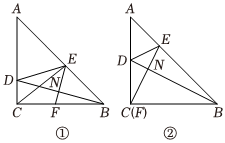
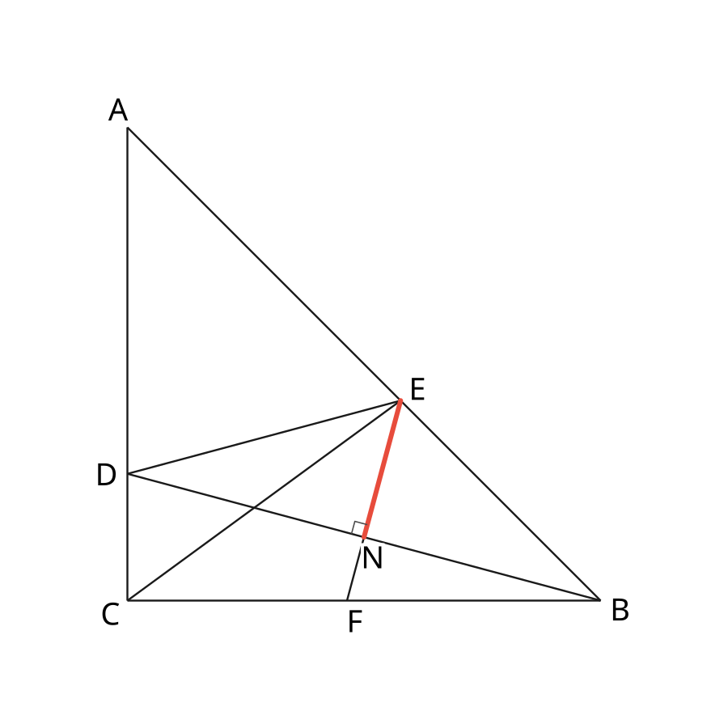
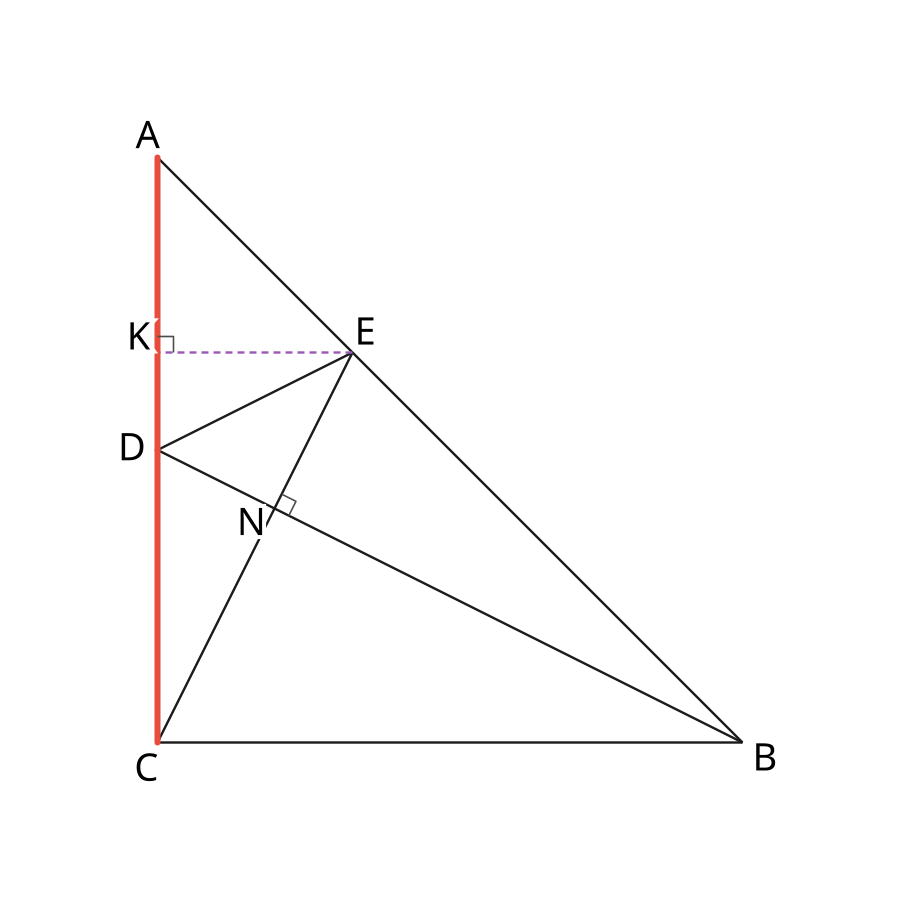

5. （2026秋•单元）如图，在 $\triangle ABC$ 中，$AC=BC$，$\angle ACB=90^\circ$，点 $D$ 是 $AC$ 上一点，点 $E$ 是 $AB$ 上一点，连结 $BD$，$DE$，$CE$，且 $\angle BDC=\angle EDA$，过点 $E$ 作 $EF\perp BD$ 交 $BD$ 于点 $N$，交 $BC$ 于点 $F$。

（1）如图 $①$，若 $\angle DBC=15^\circ$，$DE=4$，求线段 $EN$ 的长；

（2）如图 $②$，若点 $F$ 与点 $C$ 重合，求证：$AD=DC$。

> [!question]- 点击查看答案与解析
> 【答案】（1）$EN=2$；（2）见解析
>
> 【考点】等腰三角形的性质（等腰直角三角形）、直角三角形两锐角互余与三角形内角和、含 $30^\circ$ 角的直角三角形、相似三角形的判定与性质 → [[【初中数学知识点体系-人教版】#13-3 三角形的内角与外角]]、[[【初中数学知识点体系-人教版】#15-3 等腰三角形]]、[[【初中数学知识点体系-人教版】#31-2 相似三角形]]
>
> 【解析】
> （1）已知 $\angle DBC=15^\circ$，$DE=4$，求 $EN$：
> - 由 $AC=BC$，$\angle ACB=90^\circ$，知 $\triangle ABC$ 为等腰直角三角形，$\angle ABC=\angle BAC=45^\circ$。
> - 在 Rt$\triangle BCD$ 中，$\angle BDC=90^\circ-\angle DBC=75^\circ$；由已知 $\angle EDA=\angle BDC=75^\circ$。因 $A$、$D$、$C$ 共线且 $B$、$E$ 在 $AC$ 同侧，$\angle BDE=180^\circ-\angle BDC-\angle EDA=180^\circ-75^\circ-75^\circ=30^\circ$。
> - 因 $E$ 在 $AB$ 上，射线 $BE$ 即射线 $BA$，$\angle EBD=\angle ABC-\angle DBC=45^\circ-15^\circ=30^\circ$，故 $\angle EBD=\angle EDB=30^\circ$，由等角对等边得 $BE=DE=4$。
> - 由 $EF\perp BD$ 于 $N$，在 Rt$\triangle ENB$ 中 $\angle ENB=90^\circ$，$\angle EBN=30^\circ$，所以 $EN=\frac{1}{2}BE=2$。
>
> （2）点 $F$ 与点 $C$ 重合时，求证 $AD=DC$：
> - 此时 $EF$ 即为 $EC$，$EC\perp BD$ 于 $N$。过点 $E$ 作 $EK\perp AC$ 于点 $K$（见解题配图 $②$）。
> - 因 $\angle ACB=90^\circ$ 即 $BC\perp AC$，故 $EK\parallel BC$；又 $\angle KAE=\angle BAC=45^\circ$，$\angle AKE=90^\circ$，所以 $\triangle AKE$ 为等腰直角三角形，$AK=KE$。
> - 点 $K$ 在射线 $DA$ 上（若 $K$ 在射线 $DC$ 上，则 $\angle KDE=180^\circ-\angle ADE$ 为钝角，与 $\angle KDE$ 是 Rt$\triangle EKD$ 的锐角矛盾），故 $\angle KDE=\angle ADE=\angle BDC$。设 $AC=BC=1$，$CD=x$，$KE=AK=k$，则 $KD=AD-AK=1-x-k$。
> - 在 $\triangle EKD$ 与 $\triangle BCD$ 中，$\angle EKD=\angle BCD=90^\circ$，$\angle KDE=\angle CDB$，故 $\triangle EKD\sim\triangle BCD$，得 $\frac{EK}{BC}=\frac{KD}{CD}$，即 $\frac{k}{1}=\frac{1-x-k}{x}$，整理得 $k(1+x)=1-x$。①
> - 因 $EC\perp BD$，在 Rt$\triangle DNC$ 中 $\angle NDC+\angle NCD=90^\circ$，即 $\angle BDC+\angle ACE=90^\circ$；又 $\angle BCE=\angle ACB-\angle ACE=90^\circ-\angle ACE$，故 $\angle BCE=\angle BDC$；由 $EK\parallel BC$ 得 $\angle KEC=\angle BCE=\angle CDB$。
> - 在 $\triangle EKC$ 与 $\triangle DCB$ 中，$\angle EKC=\angle DCB=90^\circ$，$\angle KEC=\angle CDB$，故 $\triangle EKC\sim\triangle DCB$，得 $\frac{EK}{DC}=\frac{KC}{CB}$，即 $\frac{k}{x}=\frac{1-k}{1}$，整理得 $k(1+x)=x$。②
> - 由 ①② 得 $1-x=x$，解得 $x=\frac{1}{2}$，即 $CD=\frac{1}{2}AC$，从而 $AD=AC-CD=\frac{1}{2}AC=CD$。证毕。
> 
> 
>
> 【易错点】（1）中漏用 $A$、$D$、$C$ 共线的平角关系，$\angle BDE$ 错算成 $180^\circ-75^\circ=105^\circ$（漏减 $\angle EDA$）；或在 Rt$\triangle ENB$ 中把 $30^\circ$ 所对的直角边认错（应为 $EN=\frac{1}{2}BE$，斜边是 $BE$ 而非 $BN$）。（2）中想不到过 $E$ 作 $EK\perp AC$ 构造等腰直角三角形与两组相似；或把 $KD$ 错写成 $AK-AD$ 等，导致方程 ① 列错。
