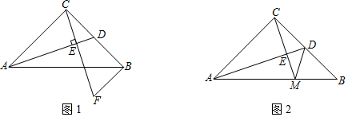
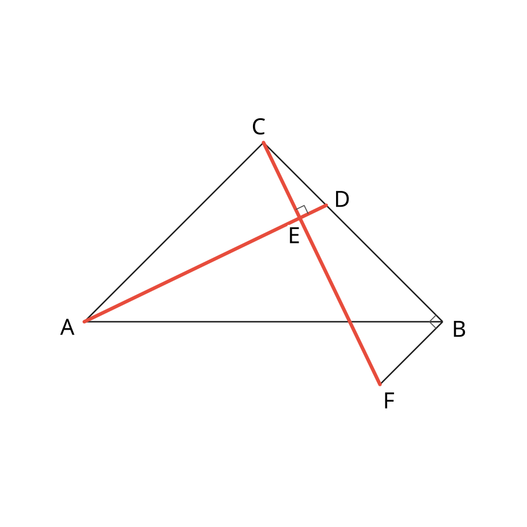
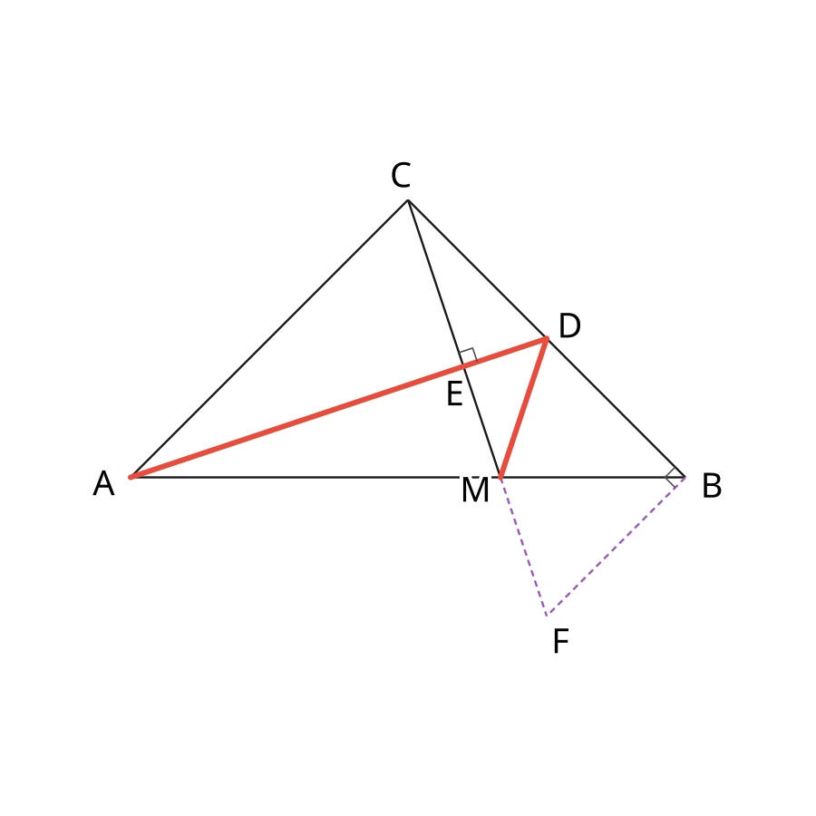

6. （2021秋•高邑县期末）在 Rt△$ABC$ 中，$\angle ACB=90^\circ$，$AC=BC$，$\angle CAB=\angle CBA=45^\circ$，$D$ 为 $BC$ 上一点，连接 $AD$，过点 $C$ 作 $CE\perp AD$ 于点 $E$。

（1）如图 1，过点 $B$ 作 $BF\perp BC$ 交 $CE$ 的延长线于点 $F$，求证：$\triangle ACD\cong\triangle CBF$；

（2）如图 2，若 $D$ 为 $BC$ 的中点，$CE$ 的延长线交 $AB$ 于点 $M$，连接 $DM$。求证：$\angle BDM=\angle ADC$。

> [!question]- 点击查看答案与解析
> 【答案】（1）（2）证明过程见解析
>
> 【考点】等腰直角三角形的性质、全等三角形的判定与性质、直角三角形两锐角互余 → [[【初中数学知识点体系-人教版】#15-3 等腰三角形]]、[[【初中数学知识点体系-人教版】#14-2 三角形全等的判定]]、[[【初中数学知识点体系-人教版】#13-3 三角形的内角与外角]]
>
> 【解析】
> （1）∵ $\angle ACB=90^\circ$，点 $D$ 在 $BC$ 上，∴ $\angle ACD=90^\circ$；∵ $BF\perp BC$，∴ $\angle CBF=90^\circ$，∴ $\angle ACD=\angle CBF$。
> - ∵ $CE\perp AD$ 于 $E$，在 Rt△$ACD$ 中 $\angle CAD+\angle ADC=90^\circ$；在 Rt△$CED$ 中 $\angle ECD+\angle EDC=90^\circ$，而 $\angle EDC=\angle ADC$，$\angle ECD=\angle BCF$（射线 $CE$ 与 $CF$、射线 $CD$ 与 $CB$ 分别重合），∴ $\angle CAD=\angle BCF$。
> - 又 $AC=CB$，∴ $\triangle ACD\cong\triangle CBF$（ASA，对应 $A\leftrightarrow C$，$C\leftrightarrow B$，$D\leftrightarrow F$）。
> （2）过点 $B$ 作 $BF\perp BC$ 交 $CE$ 的延长线于点 $F$（镜面角套路：作垂线把条件集中）。与（1）同法可证 $\triangle ACD\cong\triangle CBF$，∴ $BF=CD$，$\angle BFC=\angle CDA$。
> - ∵ $D$ 为 $BC$ 的中点，∴ $CD=BD$，∴ $BF=BD$。
> - ∵ $\angle CBF=90^\circ$，$\angle CBA=45^\circ$，点 $M$ 在 $AB$ 上，∴ $\angle FBM=\angle CBF-\angle CBA=45^\circ=\angle DBM$；又 $BM=BM$，∴ $\triangle BFM\cong\triangle BDM$（SAS）。
> - ∴ $\angle BDM=\angle BFM=\angle BFC=\angle ADC$。
> 
> 
>
> 【易错点】（1）中全等对应顶点写错（应为 $\angle CAD=\angle BCF$，而非 $\angle CAD=\angle CFB$）；（2）中把 $\angle FBM$ 误算成 $\angle CBF+\angle CBA=135^\circ$，忽略射线 $BM$（即 $BA$）在 $\angle CBF$ 内部。
