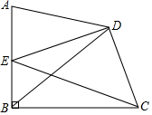
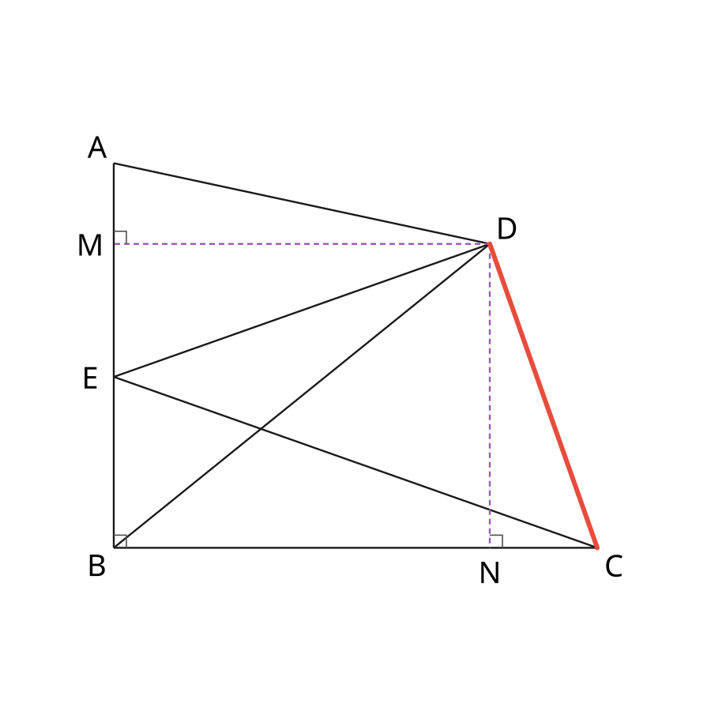

7. （2021秋•香坊区校级月考）如图，已知：四边形 $ABCD$，$\angle ABC=90^\circ$，$AB=AD$，连接 $BD$，$BD=BC$，$E$ 为 $AB$ 上一点，连接 $DE$、$CE$，$\angle AED=\angle BEC$，若 $AE=5$，$CE=12$，则 $CD$ 的长为 ___ 。

> [!question]- 点击查看答案与解析
> 【答案】$\frac{16\sqrt{2}}{3}$
>
> 【考点】等腰三角形的性质、相似三角形的判定与性质、勾股定理 → [[【初中数学知识点体系-人教版】#15-3 等腰三角形]]、[[【初中数学知识点体系-人教版】#31-2 相似三角形]]、[[【初中数学知识点体系-人教版】#20-1 勾股定理]]
>
> 【解析】
> - 镜面角套路：过点 $D$ 作 $DM\perp AB$ 于 $M$，$DN\perp BC$ 于 $N$。∵ $\angle ABC=90^\circ$，∴ 四边形 $BMDN$ 为矩形，$DN=BM$，$BN=DM$。
> - 设 $BE=x$，则 $AB=AE+BE=x+5$；在 Rt△$BCE$ 中 $BC^{2}=CE^{2}-BE^{2}=144-x^{2}$。
> - ∵ $AD=AB$，$BD=BC$，在 Rt△$ADM$ 与 Rt△$BDM$ 中由勾股定理：$DM^{2}=AD^{2}-AM^{2}=BD^{2}-BM^{2}$，即 $AB^{2}-(AB-BM)^{2}=BC^{2}-BM^{2}$，化简得 $BM=\frac{BC^{2}}{2AB}=\frac{144-x^{2}}{2(x+5)}$。
> - ∵ $\angle DEM=\angle AED=\angle BEC=\angle CEB$，$\angle DME=\angle CBE=90^\circ$，∴ $\triangle DME\sim\triangle CBE$，∴ $\frac{ME}{BE}=\frac{DM}{CB}$。代入 $ME=BM-x$、$DM^{2}=BC^{2}-BM^{2}$，平方整理得 $BM\cdot(BC^{2}+x^{2})=2BC^{2}x$，即 $\frac{144-x^{2}}{2(x+5)}\cdot 144=2(144-x^{2})x$，化简得 $x^{2}+5x-36=0$，解得 $x=4$（舍负），即 $BE=4$。
> - ∴ $AB=9$，$BC=\sqrt{144-16}=8\sqrt{2}$，$BM=\frac{128}{18}=\frac{64}{9}$，$DM=\sqrt{BC^{2}-BM^{2}}=\frac{56\sqrt{2}}{9}$。
> - ∴ $NC=BC-BN=BC-DM=\frac{16\sqrt{2}}{9}$，$DN=BM=\frac{64}{9}$，在 Rt△$DNC$ 中 $CD=\sqrt{DN^{2}+NC^{2}}=\sqrt{\frac{4096}{81}+\frac{512}{81}}=\frac{48\sqrt{2}}{9}=\frac{16\sqrt{2}}{3}$。
> - 坐标法复核：取 $B(0,0)$，$C(8\sqrt{2},0)$，$A(0,9)$，$E(0,4)$，$D\left(\frac{56\sqrt{2}}{9},\frac{64}{9}\right)$，可验证 $AB=AD=9$、$BD=BC=8\sqrt{2}$、$AE=5$、$CE=12$、$\angle AED=\angle BEC$ 全部成立，且 $CD=\frac{16\sqrt{2}}{3}$。
> 
>
> 【易错点】把垂足 $M$ 误认为 $AE$ 的中点（$DM\perp AB$ 只使 $AM$、$BM$ 分别对应两直角三角形，并非平分 $AE$）；相似比对应边写错（应为 $\frac{ME}{BE}=\frac{DM}{CB}$）；漏去 $x=-9$ 的负根。
