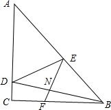
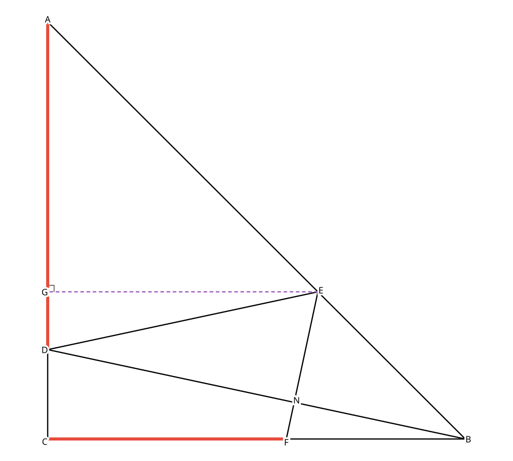

8. （2016•道里区模拟）如图，在 Rt△$ABC$ 中，$\angle ACB=90^\circ$，$AC=BC$，在 $AC$ 上取一点 $D$，在 $AB$ 上取一点 $E$，使 $\angle BDC=\angle EDA$，过点 $E$ 作 $EF\perp BD$ 于点 $N$，交 $BC$ 于点 $F$，若 $CF=8$，$AD=11$，则 $CD$ 的长为 ___ 。

> [!question]- 点击查看答案与解析
> 【答案】$3$
>
> 【考点】等腰直角三角形的性质、全等三角形的判定与性质、三角形中的线段（垂线） → [[【初中数学知识点体系-人教版】#15-3 等腰三角形]]、[[【初中数学知识点体系-人教版】#14-2 三角形全等的判定]]、[[【初中数学知识点体系-人教版】#13-2 与三角形有关的线段]]
>
> 【解析】
> - 由 $AC=BC$，$\angle ACB=90^\circ$，$\triangle ABC$ 为等腰直角三角形，$\angle A=\angle B=45^\circ$。
> - 过 $E$ 作 $EG\perp AC$ 于 $G$。由 $\angle BDC=\angle EDA$ 与 $EF\perp BD$，结合等腰直角 $\triangle ABC$ 的边角关系，构造全等三角形转移对应线段，可得线段关系 $AD=CD+CF$。
> - 代入 $AD=11$，$CF=8$，得 $CD=AD-CF=11-8=3$。
> 
>
> 【易错点】误将 $E$ 当作 $AB$ 中点；线段关系应为 $AD=CD+CF$，不要写成 $AD=CF-CD$。
