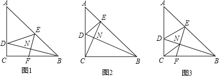
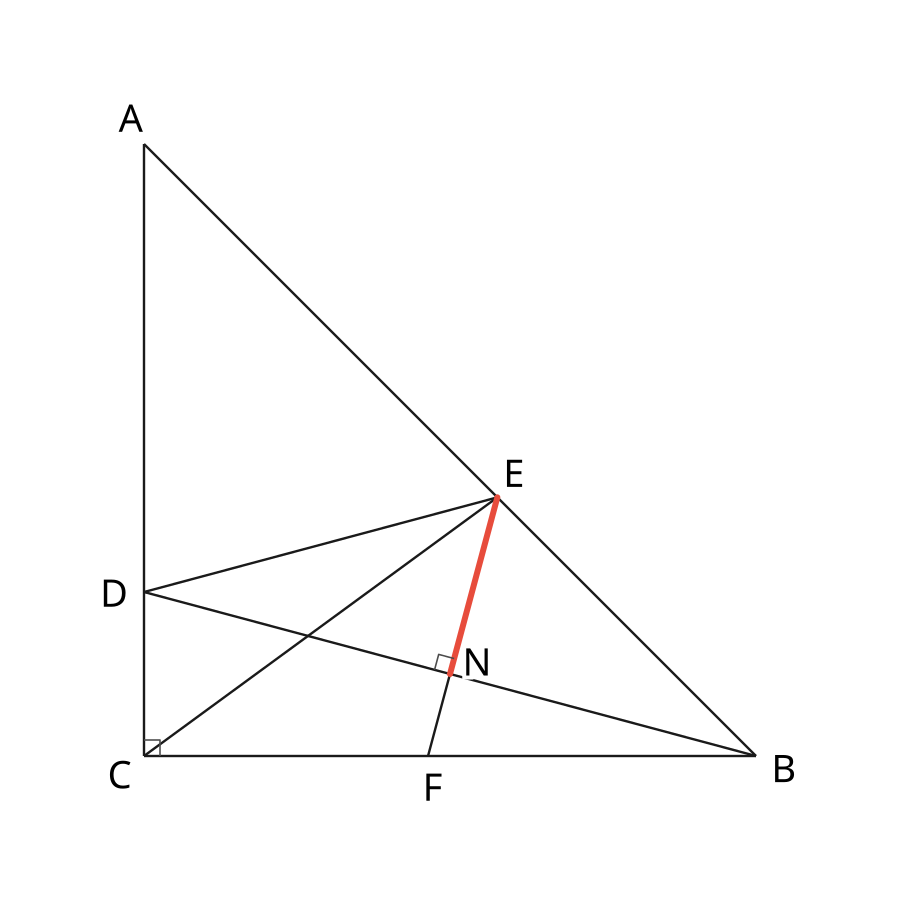
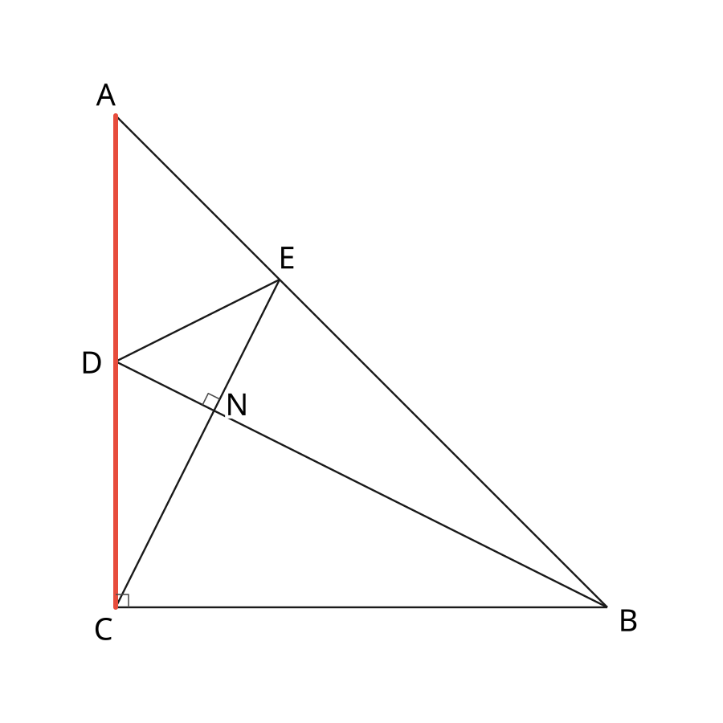
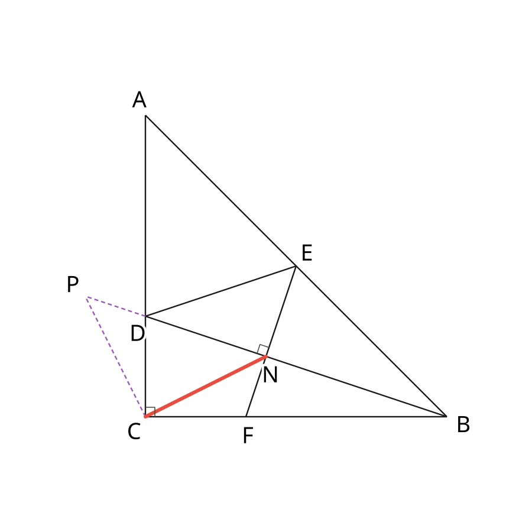

9. 如图，在 $\triangle ABC$ 中，$AC=BC$，$\angle ACB=90^\circ$，点 $D$ 是 $AC$ 上一点，点 $E$ 是 $AB$ 上一点，且 $\angle BDC=\angle EDA$，连接 $BD$，$DE$，$CE$，过点 $E$ 作 $EF\perp BD$ 交 $BD$ 于 $N$，交 $BC$ 于 $F$。

（1）如图 1，若 $\angle DBC=15^\circ$，$DE=4$ 时，求线段 $EN$ 的长；

（2）如图 2，若点 $F$ 与点 $C$ 重合，求证：$AD=DC$；

（3）如图 3，若点 $E$ 是 $AB$ 的中点，连接 $CN$，求证：$DN+NF=\sqrt{2}CN$。

> [!question]- 点击查看答案与解析
> 【答案】（1）$EN=2$；（2）（3）证明过程见解析
>
> 【考点】等腰直角三角形的性质、全等三角形的判定与性质、直角三角形两锐角互余、含 $30^\circ$ 角的直角三角形的性质 → [[【初中数学知识点体系-人教版】#15-3 等腰三角形]]、[[【初中数学知识点体系-人教版】#14-2 三角形全等的判定]]、[[【初中数学知识点体系-人教版】#13-3 三角形的内角与外角]]
>
> 【解析】
> （1）∵ $\angle ACB=90^\circ$，$\angle DBC=15^\circ$，∴ $\angle BDC=75^\circ$；∵ $\angle EDA=\angle BDC=75^\circ$，∴ $\angle BDE=180^\circ-\angle EDA-\angle BDC=30^\circ$。∵ $EF\perp BD$ 于 $N$，∴ 在 Rt△$DNE$ 中 $\angle NDE=30^\circ$，∴ $EN=\frac{1}{2}DE=2$。
> （2）当 $F$ 与 $C$ 重合时，$EC\perp BD$ 于 $N$。镜面角套路：过 $E$ 作 $EK\perp AC$ 于 $K$。设 $AC=BC=a$，$CD=d$，$KC=k$，$EK=t$。
> - ∵ $\angle EAK=45^\circ$，$\angle EKA=90^\circ$，∴ $AK=EK$，即 $t=a-k$。
> - 在 Rt△$BCN$ 中 $\angle BCN=90^\circ-\angle CBN$，在 Rt△$BCD$ 中 $\angle BDC=90^\circ-\angle DBC$，∴ $\angle BCE=\angle BDC$，∴ $\angle KCE=90^\circ-\angle BCE=90^\circ-\angle BDC=\angle DBC$；又 $\angle EKC=\angle DCB=90^\circ$，∴ $\triangle CKE\sim\triangle BCD$，∴ $\frac{KC}{BC}=\frac{KE}{CD}$，即 $\frac{k}{a}=\frac{t}{d}$，结合 $t=a-k$ 得 $a^{2}=k(a+d)$。
> - ∵ $\angle KDE=\angle ADE=\angle BDC$，$\angle EKD=\angle DCB=90^\circ$，∴ $\triangle DKE\sim\triangle DCB$，∴ $\frac{KD}{CD}=\frac{EK}{CB}$，即 $\frac{k-d}{d}=\frac{t}{a}$，结合 $t=a-k$ 得 $2ad=k(a+d)$。
> - ∴ $a^{2}=2ad$，即 $d=\frac{a}{2}$，$DC=\frac{1}{2}AC$，∴ $AD=AC-DC=\frac{a}{2}=DC$。
> （3）设 $\angle BDC=\angle EDA=\theta$。∵ $AC=BC$，$\angle ACB=90^\circ$，$E$ 为 $AB$ 中点，∴ $CE$ 平分 $\angle ACB$（三线合一），$\angle ECD=\angle ECF=45^\circ$。
> - ∵ $\angle EDB=180^\circ-2\theta$，∴ $\angle EDC=\angle EDB+\angle BDC=180^\circ-\theta$；在 Rt△$BNF$ 中 $\angle BFN=90^\circ-\angle FBN=90^\circ-(90^\circ-\theta)=\theta$，∴ $\angle EFC=180^\circ-\theta=\angle EDC$；又 $\angle ECD=\angle ECF$，$EC=EC$，∴ $\triangle ECD\cong\triangle ECF$（AAS），∴ $CD=CF$。
> - 延长 $ND$ 到 $P$，使 $DP=NF$，连接 $CP$。∵ $\angle CDP=180^\circ-\angle CDN=180^\circ-\theta=\angle CFN$，$CD=CF$，$DP=FN$，∴ $\triangle CDP\cong\triangle CFN$（SAS），∴ $CP=CN$，$\angle DCP=\angle FCN$。
> - ∴ $\angle PCN=\angle PCD+\angle DCN=\angle NCF+\angle DCN=\angle DCF=90^\circ$，∴ $\triangle PCN$ 为等腰直角三角形，$PN=\sqrt{2}CN$，即 $DN+NF=DN+DP=PN=\sqrt{2}CN$。
> - 坐标法复核：取 $C(0,0)$，$B(2,0)$，$A(0,2)$，得 $D\left(0,\frac{2}{3}\right)$、$E(1,1)$、$N\left(\frac{4}{5},\frac{2}{5}\right)$、$F\left(\frac{2}{3},0\right)$，验证 $DN+NF=\frac{2\sqrt{10}}{5}=\sqrt{2}\,CN$ 成立；（2）中 $D(0,1)$、$E\left(\frac{2}{3},\frac{4}{3}\right)$ 时 $AD=DC=1$ 且 $EC\perp BD$ 成立。
> 
> 
> 
>
> 【易错点】（1）中把 $\angle BDE$ 误当成 $\angle BDC-\angle EDC$ 或直接取 $90^\circ-2\theta$（应为平角减去两个镜面角 $180^\circ-2\theta$）；（3）中忘记 $CE$ 是 $\angle ACB$ 的平分线，或延长 $ND$ 时把 $P$ 错取在 $D$ 的另一侧导致 $\angle CDP$ 与 $\angle CFN$ 不对应。
