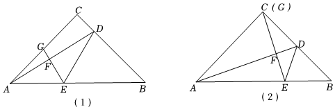
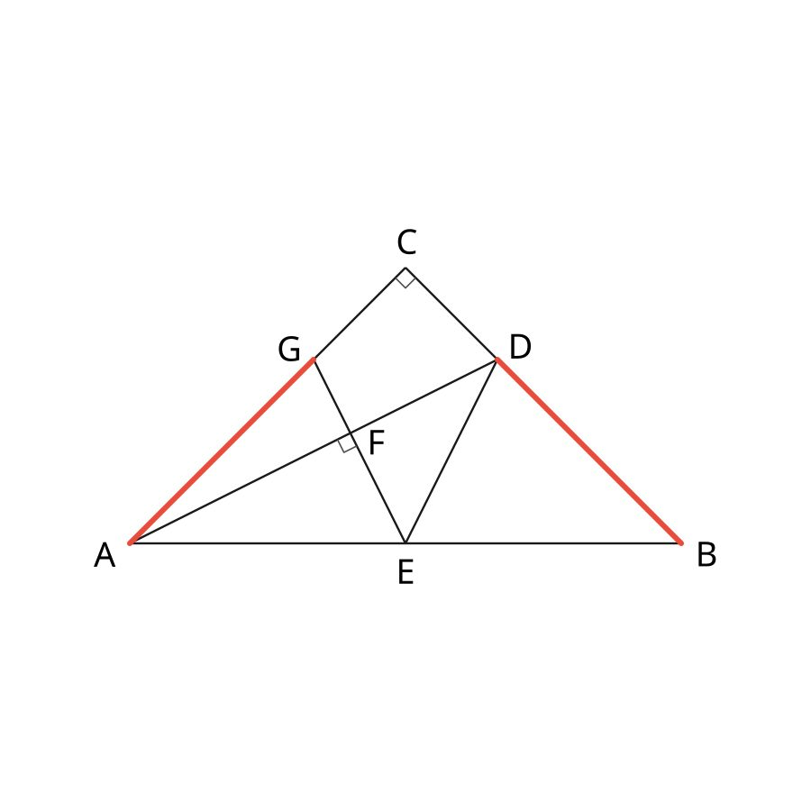
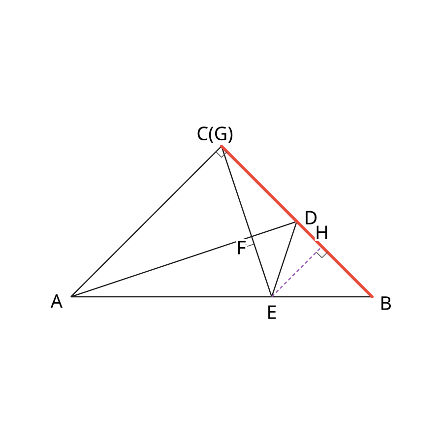

10. （2022•武汉模拟）如图，在 Rt△$ABC$ 中，$\angle ACB=90^\circ$，$AC=BC$，$D$，$E$ 分别是边 $BC$，$AB$ 上的点，$\angle ADC=\angle EDB$，过点 $E$ 作 $EF\perp AD$，垂足为 $F$，交 $AC$ 于点 $G$。

（1）如图（1），求证：$\triangle AGE\sim\triangle BDE$；

（2）如图（2），若点 $G$ 恰好与顶点 $C$ 重合，求证：$BD=CD$；

（3）如图（1），若 $\frac{CD}{CB}=\frac{1}{n}$，直接写出 $\frac{AG}{AC}$ 的值。

> [!question]- 点击查看答案与解析
> 【答案】（1）（2）证明过程见解析；（3）$\frac{AG}{AC}=\frac{2}{n}$
>
> 【考点】相似三角形的判定、等腰直角三角形的性质、直角三角形两锐角互余、全等三角形的判定与性质 → [[【初中数学知识点体系-人教版】#31-2 相似三角形]]、[[【初中数学知识点体系-人教版】#15-3 等腰三角形]]、[[【初中数学知识点体系-人教版】#13-3 三角形的内角与外角]]
>
> 【解析】
> （1）∵ $\angle ACB=90^\circ$，$AC=BC$，∴ $\angle GAE=\angle DBE=45^\circ$。∵ $EF\perp AD$ 于 $F$，∴ $\angle AFG=90^\circ$，∴ $\angle AGE=90^\circ-\angle GAF=90^\circ-\angle DAC$；又在 Rt△$ACD$ 中 $\angle ADC=90^\circ-\angle DAC$，∴ $\angle AGE=\angle ADC=\angle EDB=\angle BDE$，∴ $\triangle AGE\sim\triangle BDE$（AA，对应 $A\leftrightarrow B$，$G\leftrightarrow D$，$E\leftrightarrow E$）。
> （2）当 $G$ 与 $C$ 重合时，$EC\perp AD$ 于 $F$。镜面角套路：过 $E$ 作 $EH\perp BC$ 于 $H$。∵ $\angle EHB=90^\circ$，$\angle EBH=45^\circ$，∴ $EH=BH$。设 $AC=BC=a$，$CD=x$，$EH=BH=h$，则 $HC=a-h$，$HD=HC-CD=a-h-x$。
> - ∵ $\angle ACE=90^\circ-\angle CAF=\angle ADC$（Rt△$ACD$ 与 Rt△$AFC$ 中同为 $\angle CAD$ 的余角），∴ $\angle HCE=90^\circ-\angle ACE=90^\circ-\angle ADC=\angle DAC$；又 $\angle EHC=\angle ACD=90^\circ$，∴ $\triangle CHE\sim\triangle ACD$，∴ $\frac{EH}{DC}=\frac{CH}{CA}$，即 $\frac{h}{x}=\frac{a-h}{a}$，得 $ah=ax-xh$。
> - ∵ $\angle HDE=\angle BDE=\angle CDA$，$\angle DHE=\angle DCA=90^\circ$，∴ $\triangle DHE\sim\triangle DCA$，∴ $\frac{HE}{CA}=\frac{HD}{CD}$，即 $\frac{h}{a}=\frac{a-h-x}{x}$，得 $hx=a^{2}-ah-ax$。
> - 将 $ah=ax-xh$ 代入：$hx=a^{2}-(ax-xh)-ax=a^{2}-2ax+xh$，∴ $a^{2}=2ax$，即 $x=\frac{a}{2}$，∴ $CD=\frac{1}{2}BC$，∴ $BD=BC-CD=CD$。
> （3）$\frac{AG}{AC}=\frac{2}{n}$。复核：取坐标 $A(0,0)$，$B(4,0)$，$C(2,2)$，则 $D\left(2+\frac{2}{n},2-\frac{2}{n}\right)$；由 $\angle EDB=\angle ADC$ 解得 $E\left(\frac{4}{n+1},0\right)$，过 $E$ 作 $AD$ 的垂线交 $AC$ 于 $G$，得 $\frac{AG}{AC}=\frac{2}{n}$。取 $n=2$ 时 $G$ 恰与 $C$ 重合，与（2）的结论 $BD=CD$ 相互印证。
> 
> 
>
> 【易错点】（1）中相似对应顶点写错（应为 $\angle AGE=\angle BDE$，而不是 $\angle AGE=\angle BED$）；（2）中漏掉 $H$ 在 $D$、$B$ 之间，$HD=HC-CD$ 的线段位置关系；（3）中把 $\frac{CD}{CB}=\frac{1}{n}$ 误当作 $\frac{BD}{CB}=\frac{1}{n}$，导致结果为 $\frac{2(n-1)}{n}$ 之类的错值。
