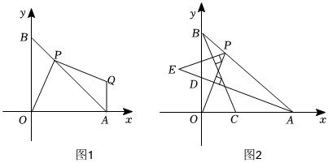
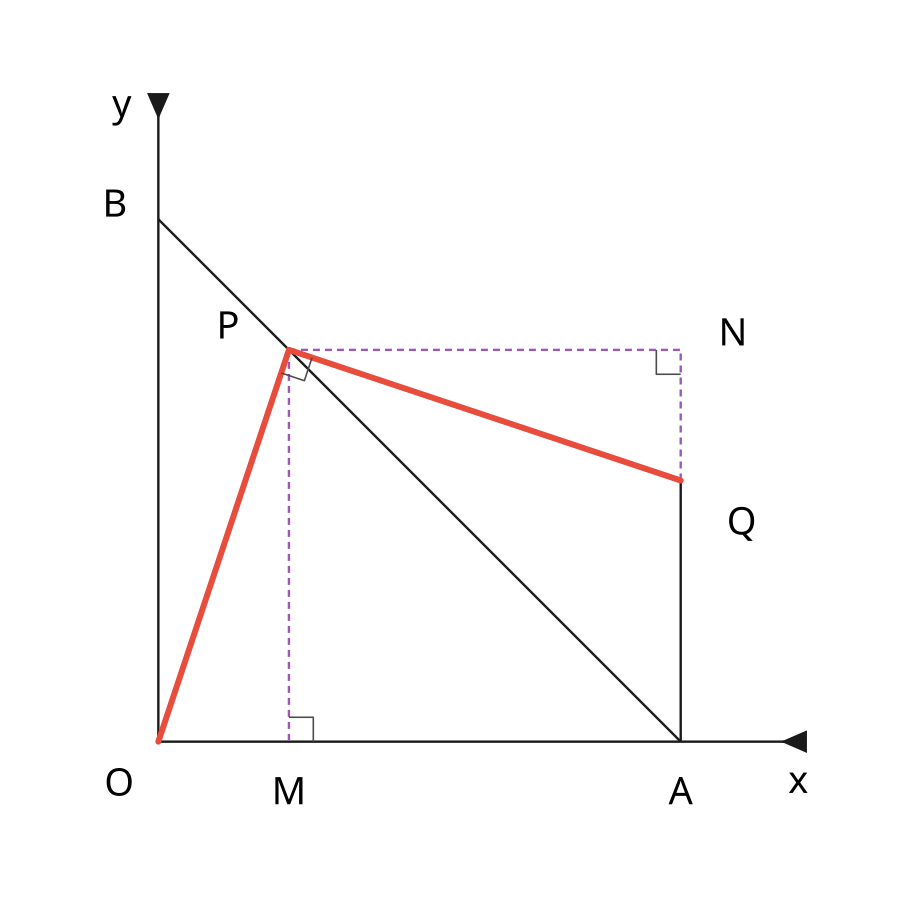
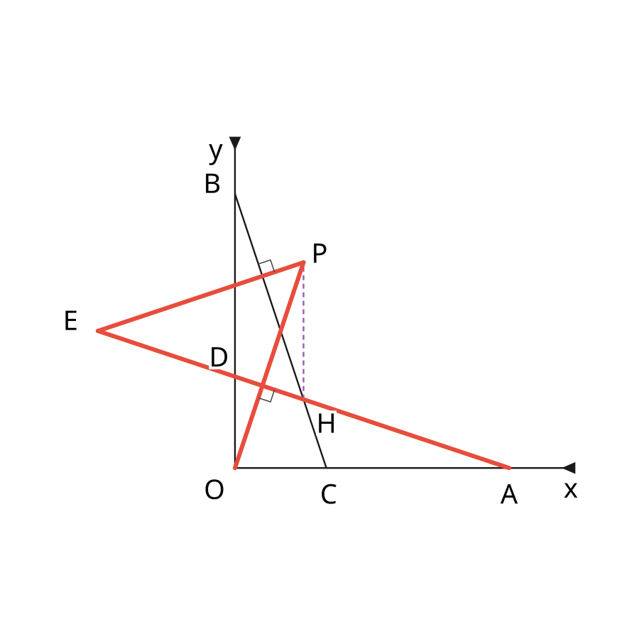

12. （2023秋•开福区校级月考）在平面直角坐标系中，点 $A(a,0)$，$B(0,b)$，$OA^2+OB^2=AB^2$，且 $a$，$b$ 满足 $(a-6)^2+\sqrt{b-6}=0$，点 $P$ 在线段 $AB$ 上（含端点），连接 $OP$。

（1）若 $AB=6\sqrt{2}$，且 $\triangle OBP$ 是以 $OB$ 为腰长的等腰三角形，求 $BP$ 的长；

（2）如图 1，过点 $A$ 作 $AQ\perp x$ 轴（$Q$ 在 $x$ 轴上方），且满足 $\angle OPQ=90^\circ$，求证：$OP=PQ$；

（3）如图 2，$C$，$D$ 分别为 $OA$，$OB$ 上的两点，且 $OC=OD$，点 $P$ 满足 $OP\perp AD$，过点 $P$ 作 $PE\perp BC$ 交 $AD$ 的延长线于点 $E$，试探究 $AE$，$OP$，$PE$ 之间的数量关系，并说明理由。

> [!question]- 点击查看答案与解析
> 【答案】（1）$BP=6$ 或 $BP=6\sqrt{2}$；（2）见解析；（3）$AE=OP+PE$
>
> 【考点】等腰三角形的性质与判定、全等三角形的判定与性质、三角形内角和与外角、勾股定理 → [[【初中数学知识点体系-人教版】#15-3 等腰三角形]]、[[【初中数学知识点体系-人教版】#14-2 三角形全等的判定]]、[[【初中数学知识点体系-人教版】#13-3 三角形的内角与外角]]、[[【初中数学知识点体系-人教版】#20-1 勾股定理]]
>
> 【解析】
> - 先定 $A$、$B$：$(a-6)^2$ 与 $\sqrt{b-6}$ 均非负且和为 $0$，故 $(a-6)^2=0$ 且 $\sqrt{b-6}=0$，得 $a=b=6$，即 $A(6,0)$、$B(0,6)$，$OA=OB=6$，$\triangle OAB$ 是等腰直角三角形，$\angle OAB=\angle OBA=45^\circ$，$AB=6\sqrt{2}$。
> - （1）$\triangle OBP$ 以 $OB$ 为腰，分两类：① 若 $OB=BP$，则 $BP=6$（此时 $P$ 在 $AB$ 内，因 $AB=6\sqrt{2}>6$ 可取）；② 若 $OB=OP$，由 $x^2+y^2=36$ 与 $x+y=6$ 联立得 $x(x-6)=0$，即 $P$ 与 $B$（舍去，不能构成三角形）或 $A$ 重合，此时 $BP=AB=6\sqrt{2}$。综上 $BP=6$ 或 $6\sqrt{2}$。
> - （2）如图 1，过 $P$ 作 $PM\perp x$ 轴于 $M$，作 $PN\perp AQ$ 于 $N$（$N$ 在 $AQ$ 的延长线上）。因 $\angle PAM=\angle OAB=45^\circ$，$\triangle PAM$ 为等腰直角三角形，$PM=AM$；又 $\angle PMA=\angle MAN=\angle ANP=90^\circ$，故四边形 $PMAN$ 是正方形，得 $PM=PN$，$\angle MPN=90^\circ$。
> - 由 $\angle OPQ=90^\circ=\angle MPN$，得 $\angle OPM=90^\circ-\angle MPQ=\angle QPN$；结合 $\angle PMO=\angle PNQ=90^\circ$、$PM=PN$，得 $\triangle PMO\cong\triangle PNQ$（ASA），故 $OP=PQ$。
> - （3）数量关系为 $AE=OP+PE$。设 $OC=OD=m$（$0<m<6$），则直线 $AD$：$mx+6y=6m$，直线 $BC$：$6x+my=6m$。由 $OP\perp AD$ 知 $OP$ 沿方向 $(m,6)$，与 $AB$（$x+y=6$）联立得 $P\left(\frac{6m}{m+6},\frac{36}{m+6}\right)$；由 $PE\perp BC$ 知 $PE$ 沿方向 $(6,m)$，与直线 $AD$ 联立得 $E\left(\frac{6(m-3)}{m},3\right)$。
> - 计算三段：$OP=\frac{6\sqrt{m^2+36}}{m+6}$，$PE=\frac{3(6-m)\sqrt{m^2+36}}{m(m+6)}$，$AE=\sqrt{\left(\frac{18}{m}\right)^2+3^2}=\frac{3\sqrt{m^2+36}}{m}$。于是 $OP+PE=\frac{6m+3(6-m)}{m(m+6)}\sqrt{m^2+36}=\frac{3(m+6)}{m(m+6)}\sqrt{m^2+36}=\frac{3\sqrt{m^2+36}}{m}=AE$，即 $AE=OP+PE$。
> - 结构注记：设 $H=AD\cap BC$，解得 $H\left(\frac{6m}{m+6},\frac{6m}{m+6}\right)$，与 $P$ 横坐标相同（$PH\perp x$ 轴），且 $OP=AH$、$PE=HE$，故 $AE=AH+HE=OP+PE$。
> 
> 
>
> 【易错点】（1）漏掉 $OB=OP$ 的情形（此时 $P$ 恰与端点 $A$ 重合，$BP=6\sqrt{2}$）；（2）误认为垂足 $N$ 落在线段 $AQ$ 上（实际在 $AQ$ 延长线上）；（3）用 $m$ 的特殊值算出结论后当成一般性证明，未对任意 $0<m<6$ 说明。
