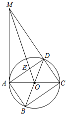
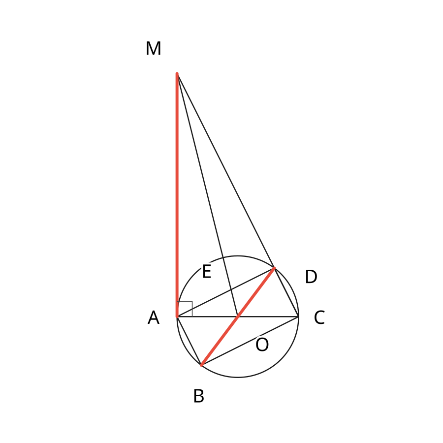

13. （2021•绵阳）如图，四边形 $ABCD$ 是 $\odot O$ 的内接矩形，过点 $A$ 的切线与 $CD$ 的延长线交于点 $M$，连接 $OM$ 与 $AD$ 交于点 $E$，$AD>1$，$CD=1$。

（1）求证：$\triangle DBC\sim\triangle AMD$；

（2）设 $AD=x$，求 $\triangle COM$ 的面积（用 $x$ 的式子表示）；

（3）若 $\angle AOE=\angle COD$，求 $OE$ 的长。

> [!question]- 点击查看答案与解析
> 【答案】（1）见解析；（2）$S_{\triangle COM}=\frac{x^3+x}{4}$；（3）$OE=\frac{3\sqrt{3}}{10}$
>
> 【考点】圆的基本性质、切线的性质、相似三角形的判定与性质、锐角三角函数 → [[【初中数学知识点体系-人教版】#29-1 圆的基本性质]]、[[【初中数学知识点体系-人教版】#30-1 直线和圆的位置关系]]、[[【初中数学知识点体系-人教版】#31-2 相似三角形]]、[[【初中数学知识点体系-人教版】#32-1 锐角三角函数]]
>
> 【解析】
> - 矩形 $ABCD$ 内接于 $\odot O$，对角线 $AC$、$BD$ 都是直径，$AC=BD=\sqrt{AD^2+CD^2}=\sqrt{x^2+1}$，半径 $R=\frac{\sqrt{x^2+1}}{2}$。
> - （1）因 $AC$ 是直径，$\angle ADC=90^\circ$，而 $M$ 在 $CD$ 的延长线上，故 $\angle ADM=90^\circ=\angle BCD$。因 $AM$ 是切线，$AM\perp AC$，在 Rt$\triangle MAC$ 中 $\angle AMC=90^\circ-\angle ACM=90^\circ-\angle ACD$；在 Rt$\triangle ADC$ 中 $\angle DAC=90^\circ-\angle ACD$；又 $\angle DBC$ 与 $\angle DAC$ 是同弧 $\overparen{DC}$ 所对的圆周角，$\angle DBC=\angle DAC$。所以 $\angle AMD=\angle DBC$，结合 $\angle BCD=\angle ADM$，得 $\triangle DBC\sim\triangle AMD$（AA）。
> - （2）由相似得 $\frac{DM}{BC}=\frac{AD}{DC}$，即 $DM=\frac{AD\cdot BC}{DC}=x\cdot x=x^2$，故 $CM=CD+DM=1+x^2$。$O$ 到直线 $CD$ 的距离等于 $\frac{BC}{2}=\frac{x}{2}$，所以 $S_{\triangle COM}=\frac{1}{2}(x^2+1)\cdot\frac{x}{2}=\frac{x^3+x}{4}$。
> - （3）$E$ 在 $OM$ 上，$\angle AOE=\angle AOM$。在 Rt$\triangle OAM$ 中，$AM=\sqrt{AD^2+DM^2}=\sqrt{x^2+x^4}=x\sqrt{x^2+1}$，$OA=\frac{\sqrt{x^2+1}}{2}$，$\tan\angle AOM=\frac{AM}{OA}=2x$。
> - 作 $OH\perp CD$ 于 $H$，则 $CH=\frac{1}{2}$，$OH=\sqrt{OC^2-CH^2}=\frac{x}{2}$，$\tan\angle COH=\frac{CH}{OH}=\frac{1}{x}$；由 $OC=OD$ 得 $\angle COD=2\angle COH$，故 $\tan\angle COD=\frac{2\cdot\frac{1}{x}}{1-\frac{1}{x^2}}=\frac{2x}{x^2-1}$。
> - 由 $\angle AOE=\angle COD$ 得 $2x=\frac{2x}{x^2-1}$，因 $x>1$，解得 $x^2=2$，$x=\sqrt{2}$。此时 $R=\frac{\sqrt{3}}{2}$，$AM=\sqrt{6}$。
> - 求 $OE$：以 $O$ 为原点、$AC$ 所在直线为 $x$ 轴建系，则 $A\left(-\frac{\sqrt{3}}{2},0\right)$，$C\left(\frac{\sqrt{3}}{2},0\right)$，$M\left(-\frac{\sqrt{3}}{2},\sqrt{6}\right)$，$D\left(\frac{\sqrt{3}}{6},\frac{\sqrt{6}}{3}\right)$。直线 $OM$：$y=-2\sqrt{2}x$；直线 $AD$：$y=\frac{\sqrt{2}}{2}\left(x+\frac{\sqrt{3}}{2}\right)$。联立解得 $E\left(-\frac{\sqrt{3}}{10},\frac{\sqrt{6}}{5}\right)$，$OE=\sqrt{\frac{3}{100}+\frac{6}{25}}=\sqrt{\frac{27}{100}}=\frac{3\sqrt{3}}{10}$。
> 
>
> 【易错点】误把 $AM$ 当作弦用垂径定理（$AM$ 是过 $A$ 的切线，$AM\perp AC$）；用二倍角正切时忽略 $x>1$ 的前提导致 $\tan\angle COD$ 符号混乱；（2）中把 $O$ 到 $CD$ 的距离错取为 $\frac{1}{2}$（应为 $\frac{BC}{2}=\frac{x}{2}$）。
