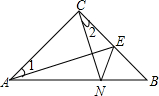
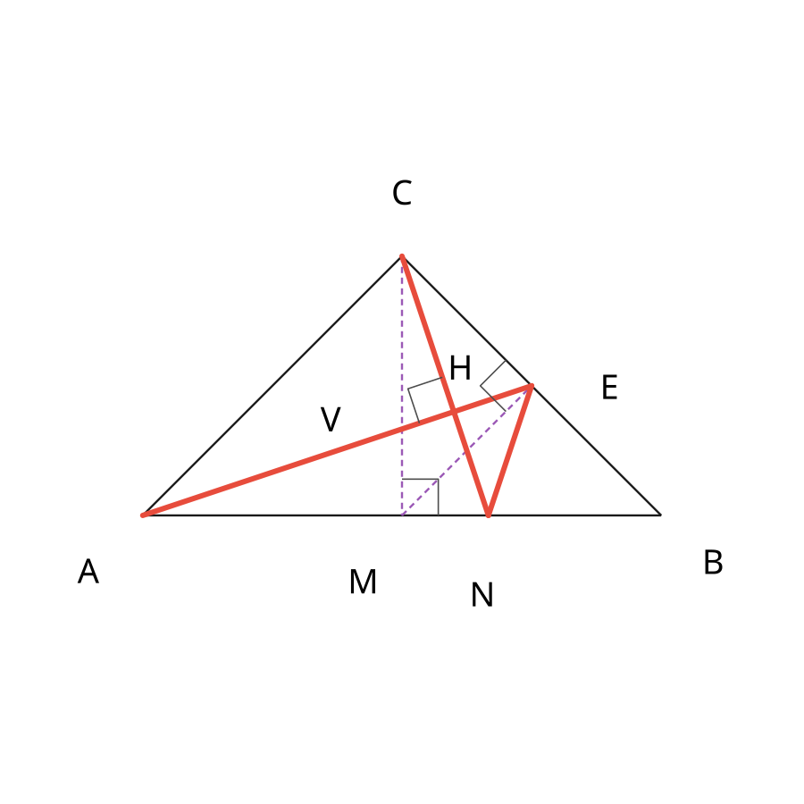

14. （2013秋•同步）如图，$\triangle ABC$ 中，$\angle CAB=\angle CBA=45^\circ$，$CA=CB$，点 $E$ 为 $BC$ 的中点，$CN\perp AE$ 交 $AB$ 于 $N$，连 $EN$，求证：$AE=CN+EN$。

> [!question]- 点击查看答案与解析
> 【答案】证明见解析（结论：$AE=CN+EN$）
>
> 【考点】等腰直角三角形的性质、全等三角形的判定与性质、三角形内角和与外角 → [[【初中数学知识点体系-人教版】#15-3 等腰三角形]]、[[【初中数学知识点体系-人教版】#14-2 三角形全等的判定]]、[[【初中数学知识点体系-人教版】#13-3 三角形的内角与外角]]
>
> 【解析】
> - 由 $\angle CAB=\angle CBA=45^\circ$ 得 $CA=CB$ 且 $\angle ACB=90^\circ$，$\triangle ABC$ 是等腰直角三角形。取斜边 $AB$ 的中点 $M$，连 $CM$ 交 $AE$ 于 $V$，连 $ME$，$CN$ 交 $AE$ 于 $H$。
> - 由等腰直角三角形“三线合一”：$CM\perp AB$，$CM$ 平分 $\angle ACB$，即 $\angle ACM=\angle BCM=45^\circ$，且 $CM=AM=BM=\frac{1}{2}AB$。
> - 角转换：因 $CN\perp AE$，在 Rt$\triangle ACH$ 中 $\angle EAC=90^\circ-\angle ACN$；又 $\angle NCB=90^\circ-\angle ACN$（$\angle ACB=90^\circ$），故 $\angle EAC=\angle NCB$，即 $\angle VAC=\angle NCB$。
> - 在 $\triangle ACV$ 与 $\triangle CBN$ 中：$\angle VAC=\angle NCB$，$AC=CB$，$\angle ACV=\angle ACM=45^\circ=\angle CBN=\angle CBA$，故 $\triangle ACV\cong\triangle CBN$（ASA）。得 $AV=CN$，$CV=BN$。
> - 于是 $MV=CM-CV=BM-BN=MN$。
> - 在等腰直角三角形 $MCB$ 中（$\angle CMB=90^\circ$，$MC=MB$），$E$ 是斜边 $CB$ 的中点，由三线合一得 $ME\perp BC$ 且 $ME$ 平分 $\angle CMB$，即 $\angle CME=\angle BME=45^\circ$，故 $\angle VME=\angle NME$。
> - 在 $\triangle MVE$ 与 $\triangle MNE$ 中：$MV=MN$，$\angle VME=\angle NME$，$ME=ME$，故 $\triangle MVE\cong\triangle MNE$（SAS），得 $VE=NE$。
> - 综上 $AE=AV+VE=CN+NE$，即 $AE=CN+EN$。$\blacksquare$
> 
>
> 【易错点】辅助线 $CM$（斜边中线）与 $ME$ 想不到，直接证 $AE=CN+EN$ 无从下手；误用 $E$ 为中点去证 $\triangle ACN$ 与某三角形全等（对应关系应为 $\triangle ACV\cong\triangle CBN$，$V$ 是 $CM$ 与 $AE$ 的交点而非已知点）；第二次全等误写成 $\triangle MVE\cong\triangle MNE$ 用 ASA（此处条件是 SAS）。
