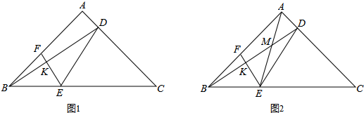
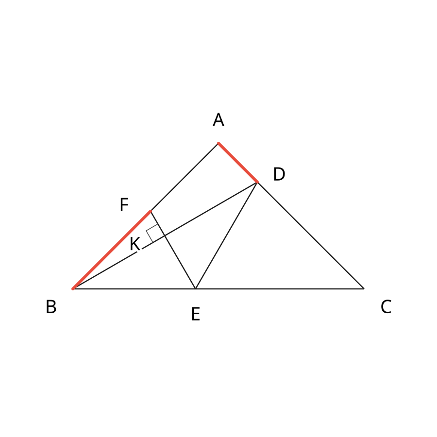
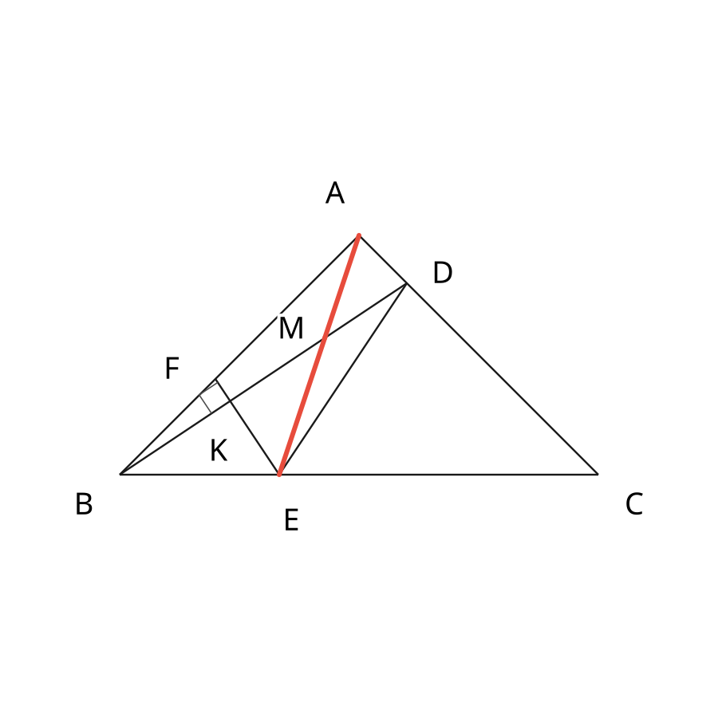

15. （2013•松北区二模）如图，在 $\triangle ABC$ 中，$AB=AC$，$\angle A=90^\circ$，点 $D$ 为 $AC$ 上一点，连接 $BD$，在边 $BC$ 上取点 $E$，使 $\angle EDC=\angle ADB$，过 $E$ 作 $EF\perp BD$ 于 $K$，交直线 $AB$ 于 $F$。

（1）如图 $①$，求证：$BF=2AD$；

（2）如图 $②$，在（1）的条件下，连接 $AE$，交 $BD$ 于 $M$，若 $ED=2EF$，请你探究线段 $AM$ 与 $ME$ 之间的数量关系，并证明你的结论。

> [!question]- 点击查看答案与解析
> 【答案】（1）证明见解析（结论：$BF=2AD$）；（2）$ME=\frac{4}{3}AM$（即 $AM:ME=3:4$）
>
> 【考点】等腰直角三角形的性质、三角形内角和与外角、勾股定理、用坐标描述平面内点的位置 → [[【初中数学知识点体系-人教版】#15-3 等腰三角形]]、[[【初中数学知识点体系-人教版】#13-3 三角形的内角与外角]]、[[【初中数学知识点体系-人教版】#20-1 勾股定理]]、[[【初中数学知识点体系-人教版】#9-1 用坐标描述平面内点的位置]]
>
> 【解析】
> - 以 $A$ 为原点、射线 $AC$ 为 $x$ 轴正半轴、射线 $AB$ 为 $y$ 轴正半轴建系。设 $AB=AC=c$，$AD=d$（$0<d<c$），则 $B(0,c)$、$C(c,0)$、$D(d,0)$，直线 $BC$：$x+y=c$。
> - 关键角：在 Rt$\triangle ABD$ 中 $\tan\angle ADB=\frac{AB}{AD}=\frac{c}{d}$。因 $\angle EDC=\angle ADB$ 为锐角且 $E$ 在 $BC$ 上（$E$ 的纵坐标为正、横坐标大于 $d$），直线 $DE$ 的斜率为 $\frac{c}{d}$，联立 $DE$ 与 $BC$ 解得 $E\left(\frac{2dc}{c+d},\frac{c(c-d)}{c+d}\right)$。
> - （1）直线 $BD$ 方向为 $(d,-c)$，故 $EF$ 方向为 $(c,d)$。过 $E$ 沿 $(c,d)$ 的直线与 $y$ 轴（直线 $AB$）交于 $t=-\frac{2d}{c+d}$ 处，得 $F(0,c-2d)$。于是 $BF=|c-(c-2d)|=2d=2AD$，即 $BF=2AD$。$\blacksquare$
> - 注：当 $d>\frac{c}{2}$ 时 $F$ 落在 $AB$ 的延长线上，与“交直线 $AB$ 于 $F$”一致，结论 $BF=2d$ 不变。
> - （2）由 $E$、$D$、$F$ 坐标：$ED=\frac{(c-d)\sqrt{c^2+d^2}}{c+d}$，$EF=\frac{2d\sqrt{c^2+d^2}}{c+d}$，故 $\frac{ED}{EF}=\frac{c-d}{2d}$。由 $ED=2EF$ 得 $c-d=4d$，即 $c=5d$（$AD:DC=1:4$）。
> - 此时 $E\left(\frac{5d}{3},\frac{10d}{3}\right)$，直线 $AE$：$y=2x$；$B(0,5d)$、$D(d,0)$，直线 $BD$：$y=5d-5x$。联立得 $M\left(\frac{5d}{7},\frac{10d}{7}\right)$。
> - 由勾股定理：$AM=\sqrt{\left(\frac{5d}{7}\right)^2+\left(\frac{10d}{7}\right)^2}=\frac{5\sqrt{5}}{7}d$，$ME=\sqrt{\left(\frac{20d}{21}\right)^2+\left(\frac{40d}{21}\right)^2}=\frac{20\sqrt{5}}{21}d$，故 $\frac{ME}{AM}=\frac{20/21}{5/7}=\frac{4}{3}$，即 $ME=\frac{4}{3}AM$。
> 
> 
>
> 【易错点】把 $D$ 误放在 $AB$ 上（题中 $D$ 在 $AC$ 上）；由 $\angle EDC=\angle ADB$ 定 $DE$ 斜率时取错方向（应为锐角情形，斜率 $\frac{c}{d}$，对应 $E$ 的横坐标大于 $d$）；忽略 $F$ 可能在 $AB$ 延长线上；（2）中把 $ED=2EF$ 解成 $c=3d$（应为 $c-d=4d$，$c=5d$）。
