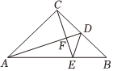
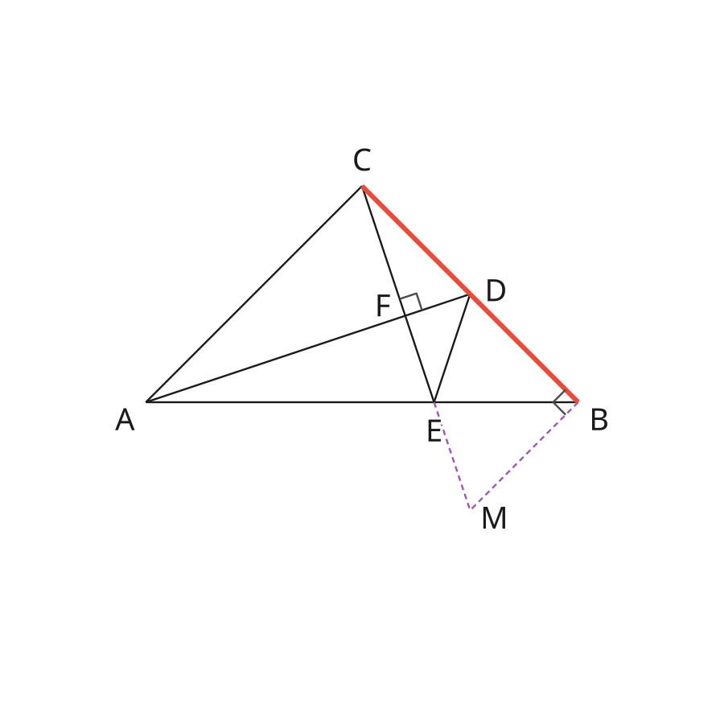

16. 如图，在 Rt△$ABC$ 中，$\angle ACB=90^\circ$，$AC=BC$，$D$，$E$ 分别是边 $BC$，$AB$ 上的点，$\angle ADC=\angle EDB$，$CE\perp AD$，垂足为 $F$。求证：$BD=CD$。

> [!question]- 点击查看答案与解析
> 【答案】证明见解析（结论 $BD=CD$ 成立）
>
> 【考点】全等三角形的判定与性质、等腰直角三角形的性质、三角形内角和与外角性质 → [[【初中数学知识点体系-人教版】#14-2 三角形全等的判定]]、[[【初中数学知识点体系-人教版】#15-3 等腰三角形]]、[[【初中数学知识点体系-人教版】#13-3 三角形的内角与外角]]
>
> 【解析】
> - 由 $\angle ACB=90^\circ$，$AC=BC$，得 $\angle BAC=\angle ABC=45^\circ$。设 $\angle ADC=\angle EDB=\theta$。
> - 因 $CE\perp AD$ 于 $F$，在 Rt△$CDF$ 中 $\angle DCF=90^\circ-\theta$，即 $\angle ECB=90^\circ-\theta$；在 Rt△$ACD$ 中 $\angle CAD=90^\circ-\angle ADC=90^\circ-\theta$，故 $\angle BCM=\angle CAD$（下文 $M$ 在射线 $CE$ 上，$\angle BCM$ 即 $\angle ECB$）。
> - 镜面角翻折：过点 $B$ 作 $BM\perp BC$，交 $CE$ 的延长线于点 $M$。在 △$BCM$ 与 △$CAD$ 中，$\angle MBC=\angle DCA=90^\circ$，$BC=CA$，$\angle BCM=\angle CAD$，故 △$BCM\cong\triangle CAD$（ASA），得 $BM=CD$。
> - 由 $BM\perp BC$ 且射线 $BE$ 在 $\angle MBC$ 内部，得 $\angle EBM=90^\circ-\angle EBC=90^\circ-45^\circ=45^\circ=\angle EBD$。
> - 再证 $\angle BEM=\angle BED$：因 $C$、$E$、$M$ 共线，$\angle BEM=180^\circ-\angle BEC$；因 $A$、$E$、$B$ 共线，$\angle AEC=180^\circ-\angle BEC$，故 $\angle BEM=\angle AEC$。在 △$AEC$ 中 $\angle AEC=180^\circ-\angle EAC-\angle ACE=180^\circ-45^\circ-\angle ACE$，而 $\angle ACE=\angle ACB-\angle ECB=90^\circ-(90^\circ-\theta)=\theta=\angle EDB$，故 $\angle AEC=135^\circ-\theta$；在 △$BED$ 中 $\angle BED=180^\circ-\angle EBD-\angle EDB=180^\circ-45^\circ-\theta=135^\circ-\theta$。所以 $\angle BEM=\angle BED$。
> - 在 △$BEM$ 与 △$BED$ 中，$\angle EBM=\angle EBD$，$BE=BE$，$\angle BEM=\angle BED$，故 △$BEM\cong\triangle BED$（ASA），得 $BD=BM$。
> - 综上，$BD=BM=CD$，即 $BD=CD$。
> 
>
> 【易错点】作 $BM\perp BC$ 时误把垂线画在 $BC$ 下方（应与 $A$ 同侧，交 $CE$ 的延长线于 $M$）；漏证 $\angle ACE=\angle EDB$ 而直接认为 $\angle AEC=\angle BED$；混淆 $BM=CD$ 与 $BD=BM$ 两步全等的先后顺序。
