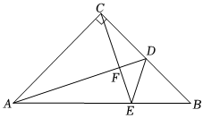
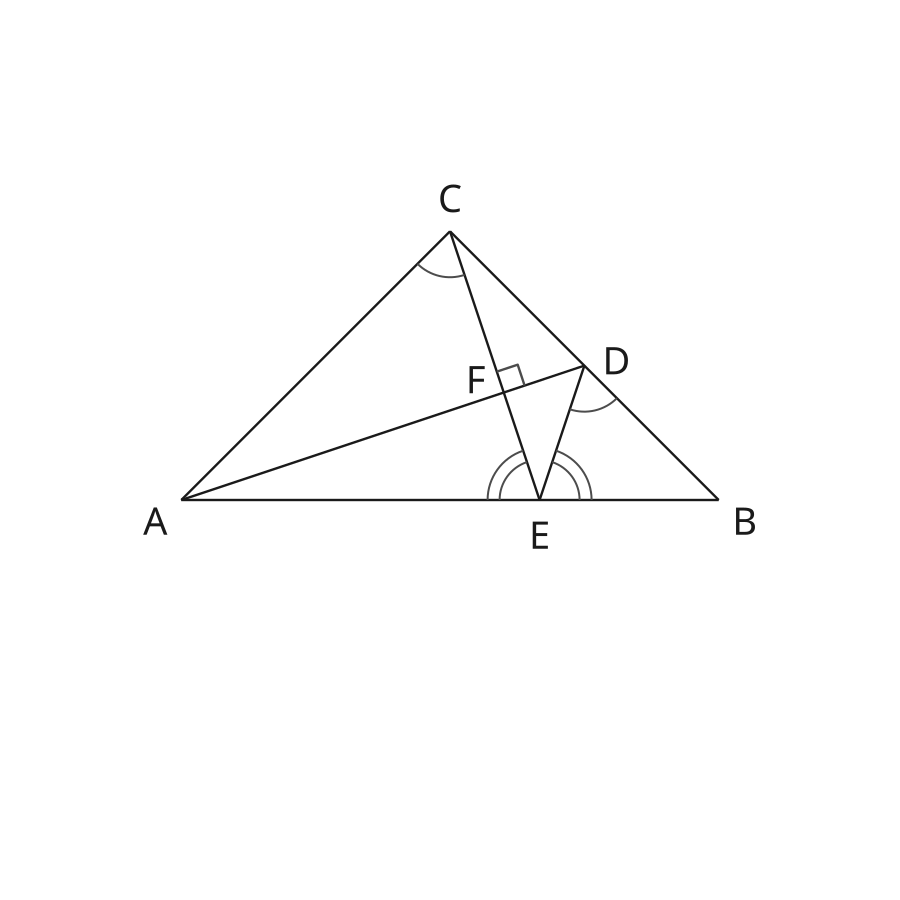
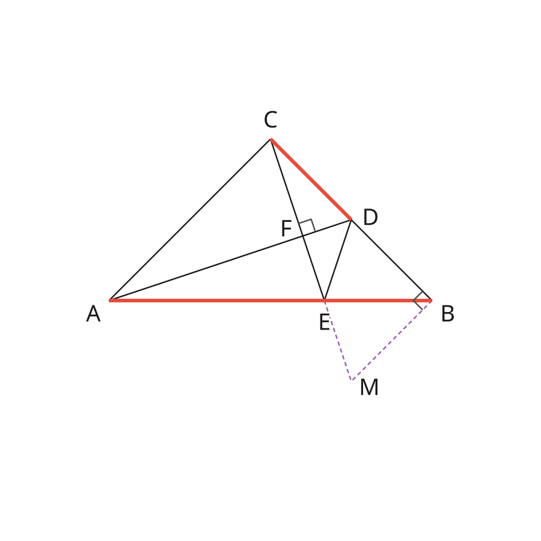

17. （2023春•大冶市期末）如图，在 Rt△$ABC$ 中，$\angle ACB=90^\circ$，$AC=BC$，$D$、$E$ 分别是边 $BC$、$AB$ 上的点，$\angle ADC=\angle EDB$，$CE\perp AD$，垂足为 $F$。

（1）求证：$\angle AEC=\angle BED$；

（2）探究线段 $AB$ 与 $CD$ 之间的数量关系，并证明你的结论。

> [!question]- 点击查看答案与解析
> 【答案】（1）证明见解析；（2）$AB=2\sqrt{2}\,CD$。
>
> 【考点】三角形内角和与外角性质、全等三角形的判定与性质、等腰直角三角形的性质、勾股定理 → [[【初中数学知识点体系-人教版】#13-3 三角形的内角与外角]]、[[【初中数学知识点体系-人教版】#14-2 三角形全等的判定]]、[[【初中数学知识点体系-人教版】#15-3 等腰三角形]]、[[【初中数学知识点体系-人教版】#20-1 勾股定理]]
>
> 【解析】
> **（1）** 设 $\angle ADC=\angle EDB=\theta$。由 $\angle ACB=90^\circ$，$AC=BC$，得 $\angle BAC=\angle ABC=45^\circ$。
> - 因 $CE\perp AD$ 于 $F$，在 Rt△$CDF$ 中 $\angle ECD=90^\circ-\angle FDC=90^\circ-\theta$，故 $\angle ACE=\angle ACB-\angle ECD=90^\circ-(90^\circ-\theta)=\theta=\angle EDB$。
> - 在 △$AEC$ 中，$\angle AEC=180^\circ-\angle EAC-\angle ACE=180^\circ-45^\circ-\theta=135^\circ-\theta$；在 △$BED$ 中，$\angle BED=180^\circ-\angle EBD-\angle EDB=180^\circ-45^\circ-\theta=135^\circ-\theta$。
> - 所以 $\angle AEC=\angle BED$。
>
> **（2）** 结论 $AB=2\sqrt{2}\,CD$，证明如下。
> - 过点 $B$ 作 $BM\perp BC$，交 $CE$ 的延长线于点 $M$（镜面角翻折，把分散的等角集中到 △$BEM$ 与 △$BED$）。则 $\angle MBC=\angle DCA=90^\circ$。
> - 由（1）中 $\angle ECD=90^\circ-\theta$，在 Rt△$ACD$ 中 $\angle CAD=90^\circ-\theta$，故 $\angle BCM=\angle CAD$；又 $BC=CA$，所以 △$BCM\cong\triangle CAD$（ASA），得 $BM=CD$。
> - 由 $BM\perp BC$ 得 $\angle EBM=90^\circ-\angle EBC=45^\circ=\angle EBD$；由 $C$、$E$、$M$ 共线得 $\angle BEM=180^\circ-\angle BEC$，而由 $A$、$E$、$B$ 共线得 $\angle AEC=180^\circ-\angle BEC$，故 $\angle BEM=\angle AEC=\angle BED$（用到（1）结论）。
> - 在 △$BEM$ 与 △$BED$ 中，$\angle EBM=\angle EBD$，$BE=BE$，$\angle BEM=\angle BED$，故 △$BEM\cong\triangle BED$（ASA），得 $BD=BM=CD$。
> - 于是 $BC=BD+CD=2CD$。在 Rt△$ABC$ 中由勾股定理 $AB=\sqrt{AC^2+BC^2}=\sqrt{2}\,BC=2\sqrt{2}\,CD$。
> 
> 
>
> 【易错点】（1）中漏掉 $\angle ACE=\theta$ 这一桥梁，直接用 $\angle ADC=\angle EDB$ 误推 $\angle AEC=\angle BED$；（2）中忘记 $AB$ 与 $BC$ 之间还有 $\sqrt{2}$ 倍关系，把结论错写成 $AB=2CD$ 或 $AB=\sqrt{2}CD$。
