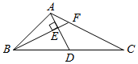
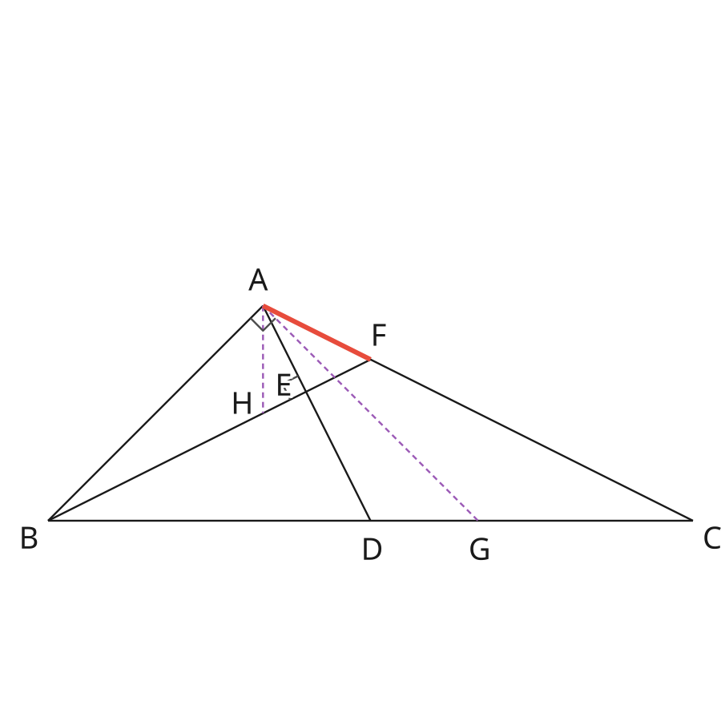

18. （2019秋•道外区期末）如图，$\triangle ABC$ 中，$\angle ABC=45^\circ$，点 $D$ 在 $BC$ 边上，且 $\angle BAC=90^\circ+\frac{1}{2}\angle DAC$，过 $B$ 作 $BE\perp AD$，垂足为 $E$，$BE$ 交 $AC$ 于 $F$，若 $AD=2$，$BF=3$，则 $AF$ 的长为 ___ 。

> [!question]- 点击查看答案与解析
> 【答案】$1$
>
> 【考点】全等三角形的判定与性质、等腰直角三角形的性质、三角形内角和与外角性质 → [[【初中数学知识点体系-人教版】#14-2 三角形全等的判定]]、[[【初中数学知识点体系-人教版】#15-3 等腰三角形]]、[[【初中数学知识点体系-人教版】#13-3 三角形的内角与外角]]
>
> 【解析】
> - 设 $\angle DAC=2\alpha$，则 $\angle BAC=90^\circ+\alpha$。在 △$ABC$ 中，$\angle ACB=180^\circ-\angle ABC-\angle BAC=180^\circ-45^\circ-(90^\circ+\alpha)=45^\circ-\alpha$。
> - 因 $\angle BAD=\angle BAC-\angle DAC=(90^\circ+\alpha)-2\alpha=90^\circ-\alpha$，且 $BE\perp AD$ 于 $E$，在 Rt△$ABE$ 中 $\angle ABE=90^\circ-\angle BAE=\alpha$，即 $\angle ABF=\alpha$。
> - 镜面角构造：过点 $A$ 作 $AG\perp AB$ 交 $BC$ 于点 $G$。在 Rt△$ABG$ 中 $\angle ABG=45^\circ$，故 $\angle AGB=45^\circ$，得 $AG=AB$；且 $\angle GAC=\angle BAC-\angle BAG=(90^\circ+\alpha)-90^\circ=\alpha=\angle DAG$（即 $AG$ 平分 $\angle DAC$）。
> - 在 △$ADC$ 中，$\angle ADC=180^\circ-\angle DAC-\angle ACD=180^\circ-2\alpha-(45^\circ-\alpha)=135^\circ-\alpha$，故 $\angle ADG=135^\circ-\alpha$（点 $D$ 在 $B$、$G$ 之间，射线 $DG$ 即射线 $DC$）。
> - 截取构造：在 $BF$ 上取点 $H$，使 $FH=FA$。在 △$ABF$ 中，$\angle AFB=180^\circ-\angle BAF-\angle ABF=180^\circ-(90^\circ+\alpha)-\alpha=90^\circ-2\alpha$；等腰 △$FAH$ 中 $\angle FHA=\angle FAH=\frac{180^\circ-\angle AFH}{2}=45^\circ+\alpha$，故 $\angle AHB=180^\circ-\angle FHA=135^\circ-\alpha=\angle ADG$。
> - 在 △$ABH$ 与 △$GAD$ 中：$\angle AHB=\angle ADG=135^\circ-\alpha$，$\angle ABH=\angle ABF=\alpha=\angle DAG$，$AB=GA$，故 △$ABH\cong\triangle GAD$（AAS），得 $BH=AD$。
> - 于是 $BF=BH+HF=AD+AF$，恒等式与 $\alpha$ 无关。代入 $AD=2$，$BF=3$，得 $AF=BF-AD=3-2=1$。
> - 数值复核：取 $\alpha=10^\circ,15^\circ,20^\circ,25^\circ,30^\circ$ 分别构图，均有 $BF=AD+AF$ 且 $FB=FC$，与推导一致。
> 
>
> 【易错点】不会利用 $\angle BAC=90^\circ+\frac{1}{2}\angle DAC$ 的"半角"特征作 $AG\perp AB$（否则 $AG$ 恰平分 $\angle DAC$）；截取 $FH=FA$ 时把 $H$ 取到 $BF$ 的延长线上；误以为需先求出 $\alpha$ 才能作答（实际 $BF=AD+AF$ 与 $\alpha$ 无关）。
