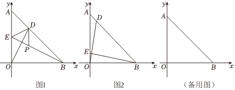
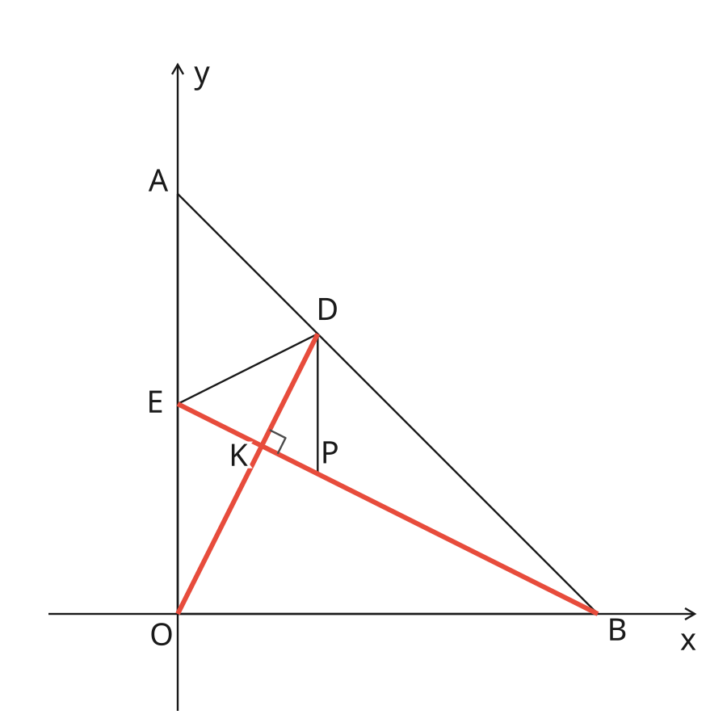
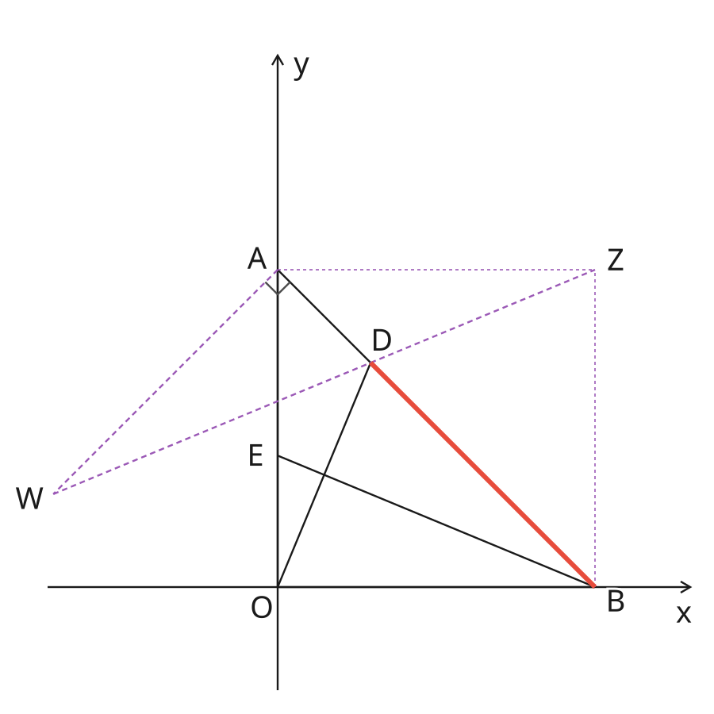

19. （2025秋•江岸区期中）在平面直角坐标系中，点 $A$ 在 $y$ 轴正半轴上，点 $B$ 在 $x$ 轴正半轴上，$A$，$B$ 两点坐标分别为 $(0,a)$，$(b,0)$，且 $a$，$b$ 满足 $|a-b|+(b-4)^2=0$，点 $E$，$D$ 分别是线段 $OA$，$AB$ 上的动点。

（1）直接写出点 $A$、点 $B$ 的坐标；

（2）如图 1，若点 $E$ 为 $AO$ 的中点，连接 $EB$，$ED$，$OD$，过点 $D$ 作 $y$ 轴的平行线交 $EB$ 于点 $P$，$ED=EP$，求证：$OD\perp BE$；

（3）如图 2，若点 $E$，点 $D$ 在运动的过程中，始终有 $OE=AD$。当 $BE+OD$ 最小时，求 $BD$ 的长度。

> [!question]- 点击查看答案与解析
> 【答案】（1）$A(0,4)$，$B(4,0)$；（2）证明见解析；（3）$BD=4$。
>
> 【考点】用坐标描述平面内点的位置、一次函数与两直线垂直、全等三角形的判定与性质、图形的轴对称（垂直平分线）、勾股定理 → [[【初中数学知识点体系-人教版】#9-1 用坐标描述平面内点的位置]]、[[【初中数学知识点体系-人教版】#23-1 一次函数]]、[[【初中数学知识点体系-人教版】#14-2 三角形全等的判定]]、[[【初中数学知识点体系-人教版】#15-1 图形的轴对称]]、[[【初中数学知识点体系-人教版】#20-1 勾股定理]]
>
> 【解析】
> **（1）** 由 $|a-b|\ge 0$，$(b-4)^2\ge 0$ 且 $|a-b|+(b-4)^2=0$，得 $b-4=0$ 且 $a-b=0$，故 $a=b=4$，即 $A(0,4)$，$B(4,0)$。
>
> **（2）** 由 $E$ 为 $AO$ 中点得 $E(0,2)$，直线 $BE$ 的解析式为 $y=-\frac{1}{2}x+2$。设 $D(m,4-m)$（$D$ 在直线 $AB$：$y=-x+4$ 上，$0<m<4$）。过 $D$ 作 $y$ 轴的平行线交 $EB$ 于 $P$，则 $P\left(m,2-\frac{m}{2}\right)$。
> - 由 $ED=EP$：$m^2+(4-m-2)^2=m^2+\left(2-\frac{m}{2}-2\right)^2$，即 $(2-m)^2=\frac{m^2}{4}$，整理得 $3m^2-16m+16=0$，解得 $m=\frac{4}{3}$ 或 $m=4$（舍去，此时 $D$ 与 $B$ 重合）。
> - 故 $D\left(\frac{4}{3},\frac{8}{3}\right)$，直线 $OD$ 为 $y=2x$；两直线斜率之积 $2\times\left(-\frac{1}{2}\right)=-1$，所以 $OD\perp BE$。
>
> **（3）** 设 $OE=AD=t$（$0\le t\le 4$），则 $E(0,t)$。由 $OA=OB=4$，$\angle AOB=90^\circ$，得 $AB=4\sqrt{2}$，直线 $AB$ 与 $x$ 轴正方向夹角为 $135^\circ$（沿 $A\to B$ 方向的单位向量为 $\left(\frac{\sqrt{2}}{2},-\frac{\sqrt{2}}{2}\right)$），故 $D\left(\frac{\sqrt{2}}{2}t,\ 4-\frac{\sqrt{2}}{2}t\right)$。
> - 镜面角翻折：以 $AB$ 为镜面，作 $O$ 关于直线 $AB$ 的对称点 $Z(4,4)$（即正方形 $OAZB$ 的第四个顶点，$AB$ 是对角线 $OZ$ 的垂直平分线）。因 $D$ 在 $AB$ 上，由垂直平分线的性质得 $OD=ZD$。
> - 全等转移：过点 $A$ 作 $AW\perp AB$，在 $AW$ 上截取 $AW=4=OB$（$W$ 在 $y$ 轴左侧），则 $\angle WAD=\angle BOE=90^\circ$。在 △$WAD$ 与 △$BOE$ 中，$WA=OB=4$，$\angle WAD=\angle BOE$，$AD=OE=t$，故 △$WAD\cong\triangle BOE$（SAS），得 $WD=BE$。可算得 $W(-2\sqrt{2},\ 4-2\sqrt{2})$。
> - 于是 $BE+OD=WD+DZ\ge WZ$，当且仅当 $W$、$D$、$Z$ 三点共线时取等号，此时 $D$ 为直线 $WZ$ 与 $AB$ 的交点。
> - 直线 $WZ$：过 $W(-2\sqrt{2},4-2\sqrt{2})$、$Z(4,4)$，与 $y=-x+4$ 联立解得 $D(4-2\sqrt{2},\ 2\sqrt{2})$。
> - 故 $BD=\sqrt{(4-(4-2\sqrt{2}))^2+(0-2\sqrt{2})^2}=\sqrt{8+8}=4$。
> - 数值复核：对 $t\in[0,4]$ 直接最小化 $\sqrt{t^2+16}+\sqrt{t^2-4\sqrt{2}t+16}$，得 $t=4\sqrt{2}-4$，$BD=4\sqrt{2}-t=4$，与几何解一致。
> 
> 
>
> 【易错点】（1）中只由 $(b-4)^2=0$ 得 $b=4$，漏用 $|a-b|=0$ 得 $a=b$；（2）中忘记舍去 $m=4$ 的退化解；（3）中把 $BD$ 误当成 $AD$（$AD=4\sqrt{2}-4$，$BD=4$），或取等条件写成 $W$、$D$、$Z$ 不共线的其他位置。
