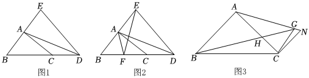
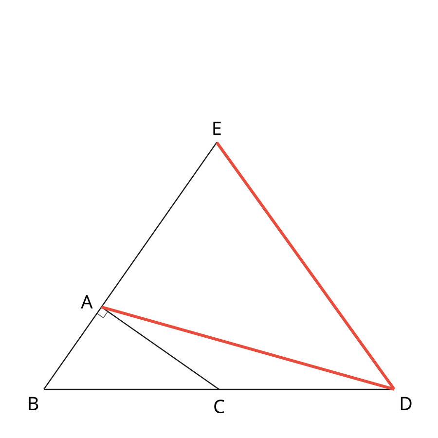
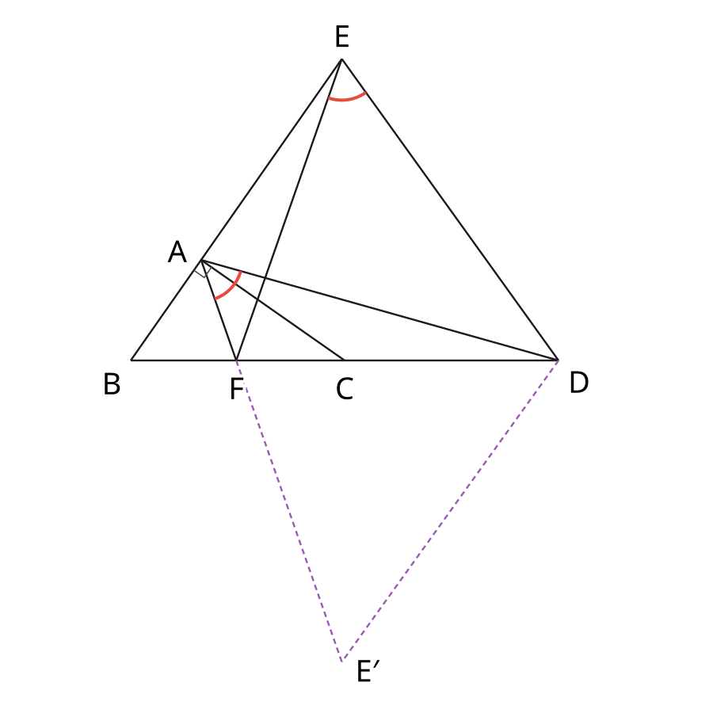
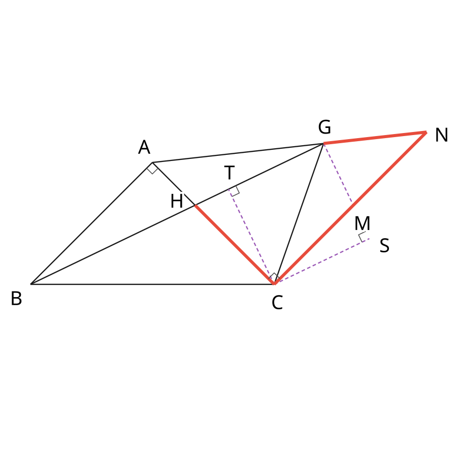

21. （2024秋•永春县校级期中）在 Rt△$ABC$ 中，$\angle BAC=90^\circ$。

（1）如图 1，$D$、$E$ 分别在 $BC$，$BA$ 的延长线上，$\angle ADE=2\angle CAD$，求证：$DA=DE$；

（2）如图 2，在（1）的条件下，点 $F$ 在 $BD$ 上，$\angle AFB=\angle EFD$，求证：$\angle FAD=\angle FED$；

（3）如图 3，若 $AB=AC$，过点 $C$ 作 $CN\parallel AB$，连接 $AN$，在 $AN$ 上取点 $G$，使 $AG=AC$，连接 $BG$ 交 $AC$ 于 $H$，连 $CG$，试探究线段 $CN$，$CH$，$GN$ 之间满足的数量关系式，并给出证明。

> [!question]- 点击查看答案与解析
> 【答案】（1）（2）为证明题，见解析；（3）$CN=CH+GN$
>
> 【考点】三角形内角和与等角对等边、邻补角与平角、全等三角形的判定与性质、等腰三角形的性质与判定、平行线的性质 → [[【初中数学知识点体系-人教版】#13-3 三角形的内角与外角]]、[[【初中数学知识点体系-人教版】#7-1 相交线]]、[[【初中数学知识点体系-人教版】#14-2 三角形全等的判定]]、[[【初中数学知识点体系-人教版】#14-1 全等三角形及其性质]]、[[【初中数学知识点体系-人教版】#15-3 等腰三角形]]、[[【初中数学知识点体系-人教版】#7-2 平行线]]
>
> 【解析】
> （1）设 $\angle CAD=\alpha$。
> - 因 $D$ 在 $BC$ 的延长线上（过 $C$ 一侧），点 $C$ 在线段 $BD$ 上，射线 $AC$ 在射线 $AB$ 与射线 $AD$ 之间，故 $\angle BAD=\angle BAC+\angle CAD=90^\circ+\alpha$。
> - 因 $E$ 在 $BA$ 的延长线上（过 $A$ 一侧），射线 $AE$ 与射线 $AB$ 互为反向延长线，故 $\angle DAE=180^\circ-\angle BAD=180^\circ-(90^\circ+\alpha)=90^\circ-\alpha$。
> - 在 $\triangle ADE$ 中，$\angle AED=180^\circ-\angle DAE-\angle ADE=180^\circ-(90^\circ-\alpha)-2\alpha=90^\circ-\alpha=\angle DAE$，故 $DA=DE$（等角对等边）。
>
> （2）延长 $AF$ 到点 $E'$，使 $FE'=FE$，连接 $DE'$。
> - 因 $B$、$F$、$D$ 共线，$\angle AFD=180^\circ-\angle AFB$；因 $A$、$F$、$E'$ 共线，$\angle DFE'=180^\circ-\angle AFD=\angle AFB=\angle EFD$。
> - 又 $FE'=FE$，$FD=FD$，故 $\triangle DFE'\cong\triangle DFE$（SAS），得 $DE'=DE$，$\angle DE'F=\angle DEF$。
> - 由（1）知 $DA=DE$，故 $DA=DE'$，$\triangle DAE'$ 是等腰三角形，$\angle DAE'=\angle DE'A$；因 $F$ 在线段 $AE'$ 上，射线 $AF$ 即射线 $AE'$、射线 $E'F$ 即射线 $E'A$，所以 $\angle FAD=\angle DAE'=\angle DE'A=\angle DE'F=\angle DEF=\angle FED$，即 $\angle FAD=\angle FED$。
>
> （3）结论：$CN=CH+GN$。证明如下，设 $\angle CAN=\beta$。
> - 因 $CN\parallel AB$，$\angle ACN=\angle BAC=90^\circ$（两直线平行，内错角相等）；又 $AB=AC$，$\angle BAC=90^\circ$，故 $\angle ABC=\angle ACB=45^\circ$。
> - 由 $AG=AC$，在 $\triangle ACG$ 中 $\angle AGC=\angle ACG=\frac{180^\circ-\beta}{2}=90^\circ-\frac{\beta}{2}$，故 $\angle GCN=\angle ACN-\angle ACG=\frac{\beta}{2}$。
> - 在线段 $CN$ 上取点 $M$，使 $MN=GN$，连接 $GM$。在 Rt$\triangle ACN$ 中 $\angle GNC=\angle ANC=90^\circ-\beta$；由 $MN=GN$ 得 $\angle NMG=\angle NGM=\frac{180^\circ-(90^\circ-\beta)}{2}=45^\circ+\frac{\beta}{2}$。
> - 于是 $\angle GMC=180^\circ-\angle NMG=135^\circ-\frac{\beta}{2}$，在 $\triangle GMC$ 中 $\angle MGC=180^\circ-\angle GMC-\angle GCM=180^\circ-(135^\circ-\frac{\beta}{2})-\frac{\beta}{2}=45^\circ$。
> - 由 $AB=AG$，$\angle BAG=\angle BAC+\angle CAG=90^\circ+\beta$，得 $\angle AGB=\angle ABG=45^\circ-\frac{\beta}{2}$；故 $\angle HGC=\angle BGC=\angle AGC-\angle AGB=(90^\circ-\frac{\beta}{2})-(45^\circ-\frac{\beta}{2})=45^\circ=\angle MGC$，即 $GC$ 平分 $\angle HGM$。
> - 过 $C$ 作 $CT\perp BG$ 于 $T$、$CS\perp GM$ 交 $GM$ 的延长线于 $S$。在 $\triangle GTC$ 与 $\triangle GSC$ 中，$\angle TGC=\angle SGC=45^\circ$，$\angle GTC=\angle GSC=90^\circ$，$GC=GC$，故 $\triangle GTC\cong\triangle GSC$（AAS），得 $CT=CS$。
> - 因 $\angle GBC=\angle ABC-\angle ABG=45^\circ-(45^\circ-\frac{\beta}{2})=\frac{\beta}{2}$，而 $\angle GHC$ 是 $\triangle BHC$ 的外角，故 $\angle GHC=\angle HBC+\angle HCB=\frac{\beta}{2}+45^\circ$，即 $\angle CHT=45^\circ+\frac{\beta}{2}$；又 $\angle CMS=180^\circ-\angle GMC=45^\circ+\frac{\beta}{2}$。
> - 在 $\triangle CTH$ 与 $\triangle CSM$ 中，$\angle CTH=\angle CSM=90^\circ$，$\angle CHT=\angle CMS$，$CT=CS$，故 $\triangle CTH\cong\triangle CSM$（AAS），得 $CH=CM$。
> - 所以 $CN=CM+MN=CH+GN$。
> 
> 
> 
>
> 【易错点】（1）中误把 $D$、$E$ 看成边 $BC$、$BA$ 上的点（实为过 $C$、过 $A$ 的延长线），把 $\angle BAD$ 错列成 $90^\circ-\alpha$；（2）需先引用（1）的结论 $DA=DE$，再"延长 $AF$ 截取 $FE'=FE$"构造全等（镜面角翻折套路），漏用 $DA=DE$ 则无法得到等腰 $\triangle DAE'$；（3）辅助线较隐蔽：先在 $CN$ 上截取 $MN=GN$ 构造等腰三角形求出 $\angle MGC=45^\circ$，再按角平分线"作两条垂线"证 $CH=CM$，只证到角度关系而漏掉 $CT=CS$ 这一步会卡住。
