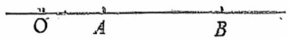

如图，下列说法正确的是（）

A. 点 O 在射线 AB 上.

B. 点 B 是直线 AB 的一个端点

C. 射线 OB 和射线 AB 是同一条射线 D. 点 A 在线段 OB 上

> [!question]- 点击查看答案与解析
> 【答案】 D
>
> 【考点】 射线、直线、线段的概念 → [[【初中数学知识点体系-人教版】#6-2 直线、射线、线段]]
>
> 【解析】
> A 选项：射线 AB 是从点 A 出发沿 AB 方向延伸，点 O 在点 A 左侧，不在射线 AB 上，故 A 错误；
> B 选项：直线没有端点，可以向两端无限延伸，故 B 错误；
> C 选项：射线 OB 的端点是 O，射线 AB 的端点是 A，端点不同，不是同一条射线，故 C 错误；
> D 选项：由图可知，点 A 在点 O 和点 B 之间，所以点 A 在线段 OB 上，故 D 正确。
>
> 【易错点】 混淆射线、直线、线段的概念，特别是射线的端点和延伸方向
