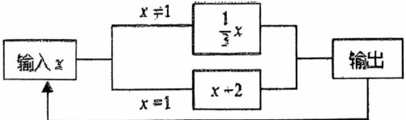

如图是一个运算程序的示意图，若开始输入 x 的值为 81，则第 2019 次输出的结果为（）

A. 3

B. 27

C. 9

D. 1

> [!question]- 点击查看答案与解析
> 【答案】 A
>
> 【考点】 找规律、循环问题 → [[【初中数学知识点体系-人教版】#2-3 有理数的乘方]]
>
> 【解析】
> 根据运算程序：若输入是 3 的倍数则除以 3，否则加 1。
> 第 1 次：$81 \div 3 = 27$
> 第 2 次：$27 \div 3 = 9$
> 第 3 次：$9 \div 3 = 3$
> 第 4 次：$3 \div 3 = 1$
> 第 5 次：$1 + 1 = 2$
> 第 6 次：$2 + 1 = 3$
> 第 7 次：$3 \div 3 = 1$
> $\cdots$
> 从第 3 次开始，输出按 $3, 1, 2$ 循环，周期为 3。
> $(2019 - 3) \div 3 = 672$（整除），所以第 2019 次输出为循环中的第 1 个数，即 $3$。
> 故选 A。
>
> 【易错点】 未正确找到循环起点和周期，导致计算错误
