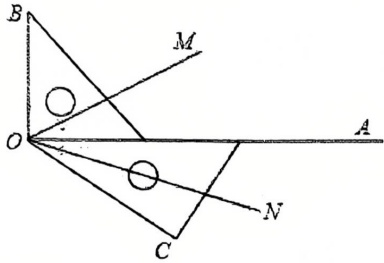

如图，一副直角三角板摆放在一起，射线OM平分∠BOC、ON平分∠AOC，∠MON的度数为\_\_\_.

> [!question]- 点击查看答案与解析
> 【答案】 $45^{\circ}$
>
> 【考点】 角平分线、角度的计算 → [[【初中数学知识点体系-人教版】#6-3 角]]
>
> 【解析】
> 由图可知，两个直角三角板直角顶点重合摆放：
> $\angle AOC = 45^{\circ}$，$\angle BOC = 135^{\circ}$。
> OM 平分 $\angle BOC$，则 $\angle MOC = 67.5^{\circ}$；
> ON 平分 $\angle AOC$，则 $\angle NOC = 22.5^{\circ}$；
> $\angle MON = \angle MOC - \angle NOC = 67.5^{\circ} - 22.5^{\circ} = 45^{\circ}$。
>
> 【易错点】 不能正确识别图中角度关系，角平分线性质运用错误
