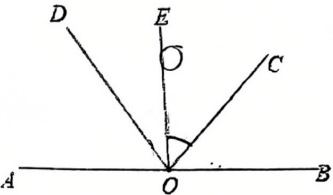

如图，已知，O 是直线 AB 上一点，∠AOE = ∠COD，射线 OC 平分 ∠BOE，∠EOC = 50°．求 ∠DOE 的度数．

> [!question]- 点击查看答案与解析
> 【答案】 $30^{\circ}$
>
> 【考点】 角平分线、角度的计算 → [[【初中数学知识点体系-人教版】#6-3 角]]
>
> 【解析】
> 因为 OC 平分 $\angle BOE$，所以 $\angle BOC = \angle EOC = 50^{\circ}$。
> 所以 $\angle BOE = 100^{\circ}$。
> 因为 O 在直线 AB 上，所以 $\angle AOE = 180^{\circ} - 100^{\circ} = 80^{\circ}$。
> 因为 $\angle COD = \angle AOE$，所以 $\angle COD = 80^{\circ}$。
> 所以 $\angle DOE = \angle COD - \angle EOC = 80^{\circ} - 50^{\circ} = 30^{\circ}$。
>
> 【易错点】 不能利用平角等于 $180^{\circ}$ 的性质求出 $\angle AOE$
