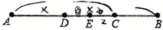

如图已知点 C 为 AB 上一点，AC=12cm， $CB=\frac{2}{3}AC$，D、E 分别为 AC、AB 的中点，求 DE 的长.

> [!question]- 点击查看答案与解析
> 【答案】 $4\text{ cm}$
>
> 【考点】 线段的中点、线段长度的计算 → [[【初中数学知识点体系-人教版】#6-2 直线、射线、线段]]
>
> 【解析】
> $AC = 12\text{ cm}$，$CB = \frac{2}{3}AC = \frac{2}{3} \times 12 = 8\text{ cm}$。
> $AB = AC + CB = 12 + 8 = 20\text{ cm}$。
> D 是 AC 中点，$AD = \frac{1}{2}AC = 6\text{ cm}$。
> E 是 AB 中点，$AE = \frac{1}{2}AB = 10\text{ cm}$。
> $DE = AE - AD = 10 - 6 = 4\text{ cm}$。
>
> 【易错点】 中点概念理解错误，或线段关系搞混
