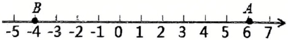

如图，已知数轴上的点 A 表示的数为 6，点 B 表示的数为 -4，点 C 到点 A、点 B 的距离相等，动点 P 从点 B 出发，以每秒 2 个单位长度的速度沿数轴向右匀速运动，设运动时间为 $x$（ $x$ 大于 0）秒.

(1) 点 C 表示的数是 \_\_\_；

(2) 当 x=\_\_\_ 秒时，点 P 到达点 A 处？

(3) 运动过程中点 P 表示的数是 \_\_\_ （用含字母 x 的式子表示）；

(4) 当 P, C 之间的距离为 2 个单位长度时，求 x 的值.

> [!question]- 点击查看答案与解析
> 【答案】 (1) $1$；(2) $5$；(3) $-4 + 2x$；(4) $x = 1.5$ 或 $x = 3.5$
>
> 【考点】 数轴、动点问题、一元一次方程的应用 → [[【初中数学知识点体系-人教版】#5-3 实际问题与一元一次方程]]
>
> 【解析】
> (1) 点 C 到点 A（表示 6）、点 B（表示 $-4$）的距离相等，
> C 是 AB 的中点，$C = \frac{6 + (-4)}{2} = 1$。
>
> (2) P 从 B 出发向右运动，到达 A 时运动距离为 $6 - (-4) = 10$ 个单位，
> 时间 $x = \frac{10}{2} = 5$ 秒。
>
> (3) P 从 $-4$ 出发，以每秒 2 个单位向右运动，
> 运动过程中 P 表示的数为 $-4 + 2x$。
>
> (4) P、C 之间的距离为 2，即 $|(-4 + 2x) - 1| = 2$，
> $|-5 + 2x| = 2$，
> $-5 + 2x = 2$ 或 $-5 + 2x = -2$，
> 解得 $x = 3.5$ 或 $x = 1.5$。
>
> 【易错点】 (4) 忽略绝对值的两种情况导致漏解；动点位置的代数表示错误
