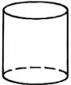
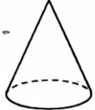
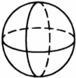
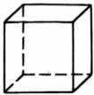

下列四个几何体中，是圆锥的为（）

A

B

C

D

> [!question]- 点击查看答案与解析
> 【答案】B
> 
> 【考点】常见几何体的识别 → [[【初中数学知识点体系-人教版】#6-1 几何图形]]
> 
> 【解析】
> - 选项A：是圆柱，错误；
> - 选项B：是圆锥，有一个圆形底面和一个顶点，正确；
> - 选项C：是正方体（或长方体），错误；
> - 选项D：是球体，错误。
> 
> 【易错点】混淆圆柱和圆锥，圆锥有一个顶点而圆柱没有。
