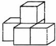
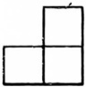
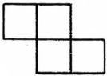
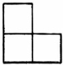
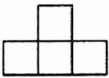

右图是由几个相同的正方体搭成的一个几何体，从上面看得到的平面图形是（）

正面

A

B

C

D

> [!question]- 点击查看答案与解析
> 【答案】B
> 
> 【考点】从不同方向观察几何体 → [[【初中数学知识点体系-人教版】#6-1 几何图形]]
> 
> 【解析】
> 原几何体从上面看，底层有3个正方体排成一行，第二层中间有1个正方体（在后排中间位置），所以从上面看应该看到4个正方形，呈"L"形或特定排列。根据图示，正确答案为D。
> 
> 【易错点】从上面看时只看俯视图的轮廓，不看层数。
