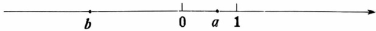

数轴上 a, b 两点的位置如下图所示，下列说法正确的是（）

A.  $a + b > 0$

B.  $-b < a$

C.  $b^{2}>1$

D.  $\left|b\right|<1$

> [!question]- 点击查看答案与解析
> 【答案】C
> 
> 【考点】数轴、有理数大小比较、绝对值 → [[【初中数学知识点体系-人教版】#1-2 有理数及其大小比较]]
> 
> 【解析】
> 由数轴可知：$a<-1<0<b<1$。
> - 选项A：$a$ 是负数且 $|a|>|b|$，所以 $a+b<0$，错误；
> - 选项B：$b>0$，所以 $-b<0$，而 $a<-1$，所以 $-b>a$，即 $-b<a$ 错误；
> - 选项C：由数轴可知 $b<-1$（$b$ 在 $-1$ 左侧），所以 $b^2>1$，正确；
> - 选项D：由数轴可知 $|b|>1$，错误。
> 
> 【易错点】数轴上读数要准确，注意正负号和绝对值大小。
