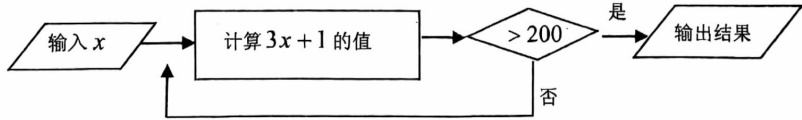

按下面的程序计算，若开始输入的值 x 为正数，最后输出的结果为 283，则满足条件的 x 不同值最多有

A. 6 个

B. 5 个

C. 4 个

D. 3 个

> [!question]- 点击查看答案与解析
> 【答案】D
> 
> 【考点】程序运算、一元一次方程 → [[【初中数学知识点体系-人教版】#5-3 实际问题与一元一次方程]]
> 
> 【解析】
> 程序为：输入 $x$，计算 $3x+1$，若结果 $>100$ 则输出，否则将结果作为新的 $x$ 继续计算。
> 最后输出283，逆推：
> 
> 第1次逆推：$3x+1=283$，$3x=282$，$x=94$。
> 第2次逆推：$3x+1=94$，$3x=93$，$x=31$。
> 第3次逆推：$3x+1=31$，$3x=30$，$x=10$。
> 第4次逆推：$3x+1=10$，$3x=9$，$x=3$。
> 第5次逆推：$3x+1=3$，$3x=2$，$x=\frac{2}{3}$。
> 第6次逆推：$3x+1=\frac{2}{3}$，$x=-\frac{1}{9}<0$，舍去。
> 
> 所以满足条件的正数 $x$ 有94、31、10、3、$\frac{2}{3}$，共5个。
> 
> 【易错点】逆推时注意每一步的值是否为正数，以及循环条件。
