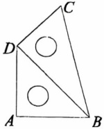

将一副直角三角板如图所示摆放，则图中  $\angle ABC$ 的大小为___。

> [!question]- 点击查看答案与解析
> 【答案】$135^\circ$
> 
> 【考点】角的和差、直角三角板 → [[【初中数学知识点体系-人教版】#6-3 角]]
> 
> 【解析】
> 一副直角三角板，一个是 $45^\circ-45^\circ-90^\circ$，另一个是 $30^\circ-60^\circ-90^\circ$。
> 从图中摆放可知 $\angle ABC=90^\circ+45^\circ=135^\circ$。
> 
> 【易错点】熟记直角三角板的三个角的度数。
