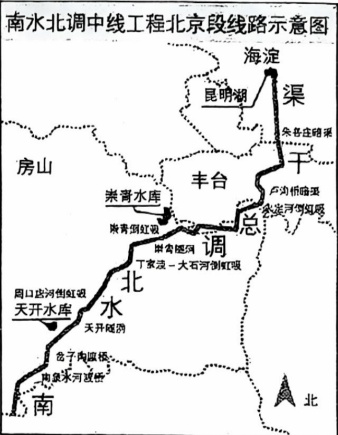
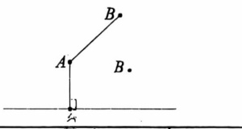

南水北调中线工程北京段干线工程起自房山北拒马河，经房山区至大宁水库，穿永定河，过丰台，沿西四环路北上至终点颐和园团城湖，全长80公里。主要采取地下涵管压力输水方式，在输水过程中全程计量、跟踪监测、精细调度、高效配置，确保最大限度利用南水。北京严格遵循南水北调工程“三先三后”原则，科学制定用水计划，研究确立了“节、喝、存、补”的用水方针，2017-2018年度入京水量达12.10亿立方米，成为历年来北京调水最多的一个调水年度。如右图，在铺设地下管道的时候，需要把拒马河沿线的管道l中的水引到房山水站A，B两处。

工人师傅设计了一种最节省材料的修建方案如下：

画法：如图，

(1) 连接  $AB;$

(2) 过点 A 画线段  $AC \perp$ 直线 I 于点 C.

所以线段 AB 和线段 AC 即为所求.

请回答：工人师傅的画图依据是 _________.

> [!question]- 点击查看答案与解析
> 【答案】两点之间线段最短；垂线段最短
> 
> 【考点】线段的性质、点到直线的距离 → [[【初中数学知识点体系-人教版】#6-2 直线、射线、线段]]
> 
> 【解析】
> 连接 $AB$ 的依据是"两点之间线段最短"；
> 过点 $A$ 作 $AC\perp l$ 的依据是"垂线段最短"。
> 
> 【易错点】区分"两点之间线段最短"和"垂线段最短"的应用场景。
