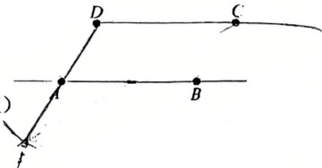

按要求画图，并回答问题：

如图，同一平面上有四点 A, B, C, D.

(1) 画出直线 AB，射线 DC;

(2) 延长线段 DA 至点 E，使 AE = AD;

(3) 画一点 P，使点 P 既在直线 AB 上，又在线段 CE 上；

(4) 用量角器量得  $\angle AEP$ 的大小约为___°。(精确到度)

> [!question]- 点击查看答案与解析
> 【答案】见解析
> 
> 【考点】直线、射线、线段的画法 → [[【初中数学知识点体系-人教版】#6-2 直线、射线、线段]]
> 
> 【解析】
> (1) 直线 $AB$ 过 $A$、$B$ 两点向两端无限延伸；射线 $DC$ 以 $D$ 为端点经过 $C$ 向一方延伸。
> 
> (2) 延长线段 $DA$ 至点 $E$，使 $AE=AD$（用刻度尺或圆规作图）。
> 
> (3) 画直线 $AB$ 与线段 $CE$ 的交点 $P$。
> 
> (4) 用量角器量得 $\angle AEP$ 的大小约为实际角度（根据具体图形）。
> 
> 【易错点】直线、射线、线段的概念区别，延长的方向要正确。
