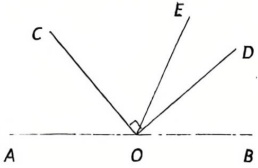
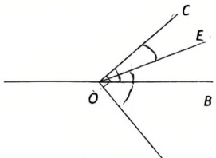

填空，完成下列说理过程：

O 是直线 AB 上一点， $\angle COD = 90^\circ$，OE 平分  $\angle BOC$.

(1) 如图 1，若  $\angle AOC = 50^\circ$，求  $\angle DOE$ 的度数；

图 1

解：∵O 是直线 AB 上一点，

$\therefore\angle AOC+\angle BOC=180^{\circ}.$

$\because\angle AOC=50^{\circ},$

$\therefore\angle BOC=130^{\circ}.$

∵OE 平分 ∠BOC（已知），

$\therefore \angle COE = \frac{1}{2} \angle BOC$ （\_\_\_）.

$\therefore \angle COE = \_\_\_\_\_\_^\circ.$

∵∠COD=90°，∠DOE=∠___-∠___，

$\therefore\angle DOE=\underline{\quad}\quad^{\circ}.$

(2) 将图 1 中 ∠COD 按顺时针方向转至图 2 所示的位置，OE 仍然平分 ∠BOC. 试猜想 ∠AOC 与 ∠DOE 的度数之间的关系为：___

图 2

> [!question]- 点击查看答案与解析
> 【答案】(1) 角平分线的定义；65；$COD$；$COE$；25；(2) $\angle DOE=\frac{1}{2}\angle AOC$
> 
> 【考点】角的平分线、角的和差 → [[【初中数学知识点体系-人教版】#6-3 角]]
> 
> 【解析】
> (1) ∵ $O$ 是直线 $AB$ 上一点，
> $\therefore\angle AOC+\angle BOC=180^\circ$。
> ∵ $\angle AOC=50^\circ$，
> $\therefore\angle BOC=130^\circ$。
> 
> ∵ $OE$ 平分 $\angle BOC$（已知），
> $\therefore\angle COE=\frac{1}{2}\angle BOC$（角平分线的定义）。
> $\therefore\angle COE=65^\circ$。
> 
> ∵ $\angle COD=90^\circ$，$\angle DOE=\angle COD-\angle COE$，
> $\therefore\angle DOE=90^\circ-65^\circ=25^\circ$。
> 
> (2) 猜想：$\angle DOE=\frac{1}{2}\angle AOC$。
> 
> 理由：设 $\angle AOC=\alpha$，则 $\angle BOC=180^\circ-\alpha$。
> ∵ $OE$ 平分 $\angle BOC$，$\therefore\angle COE=\frac{1}{2}(180^\circ-\alpha)=90^\circ-\frac{\alpha}{2}$。
> ∵ $\angle COD=90^\circ$，
> $\therefore\angle DOE=\angle COD-\angle COE=90^\circ-(90^\circ-\frac{\alpha}{2})=\frac{\alpha}{2}=\frac{1}{2}\angle AOC$。
> 
> 【易错点】角平分线的定义，以及 $\angle DOE$ 与已知角的关系推导。
