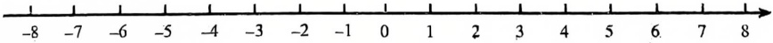
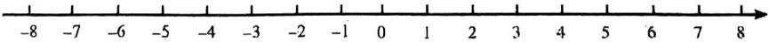

对于数轴上不重合的两点 A, B, 给出如下定义: 若数轴上存在一点 M, 通过比较线段 AM 和 BM 的长度, 将较短线段的长度定义为点 M 到线段 AB 的“绝对距离”. 若线段 AM 和 BM 的长度相等, 将线段 AM 或 BM 的长度定义为点 M 到线段 AB 的“绝对距离”.

(1) 当数轴上原点为O，点A表示的数为-1，点B表示的数为5时.

$①$ 点O到线段AB的“绝对距离”为___；

$②$ 点M表示的数为m，若点M到线段AB的“绝对距离”为3，则m的值为___；

(2) 在数轴上，点P表示的数为-6，点A表示的数为-3，点B表示的数为2. 点P以每秒2个单位长度的速度向正半轴方向移动时，点B同时以每秒1个单位长度的速度向负半轴方向移动. 设移动的时间为 $t(t>0)$秒，当点P到线段AB的“绝对距离”为2时，求t的值.

备用图1

备用图2

> [!question]- 点击查看答案与解析
> 【答案】(1) $①$ 1；$②$ -4或2或8；(2) $t=\frac{1}{2}$或$t=\frac{10}{3}$
> 
> 【考点】数轴、新定义、动点问题 → [[【初中数学知识点体系-人教版】#1-2 有理数及其大小比较]]
> 
> 【解析】
> (1) $①$ $A(-1)$，$B(5)$，$O(0)$。
> $AO=|0-(-1)|=1$，$BO=|0-5|=5$。
> 较短线段为 $AO=1$，所以"绝对距离"为1。
> 
>  $②$ 点 $M(m)$，$AM=|m-(-1)|=|m+1|$，$BM=|m-5|$。
> "绝对距离"为3，即 $\min(AM,BM)=3$。
> 
> 情况一：$AM=3\le BM$，$|m+1|=3$，$m=2$ 或 $m=-4$。
> 当 $m=2$ 时，$BM=|2-5|=3$，$AM=BM=3$，符合。
> 当 $m=-4$ 时，$BM=|-4-5|=9\ge 3$，符合。
> 
> 情况二：$BM=3\le AM$，$|m-5|=3$，$m=8$ 或 $m=2$。
> 当 $m=8$ 时，$AM=|8+1|=9\ge 3$，符合。
> 当 $m=2$ 时，已在情况一中。
> 
> 综上，$m=-4$ 或 $m=2$ 或 $m=8$。
> 
> (2) $P$ 的初始位置为 $-6$，速度为2单位/秒向右。
> $A$ 的位置为 $-3$，固定不动。
> $B$ 的初始位置为 $2$，速度为1单位/秒向左。
> 
> $t$ 秒后：$P$ 表示的数为 $-6+2t$，$A$ 仍为 $-3$，$B$ 表示的数为 $2-t$。
> 
> $PA=|(-6+2t)-(-3)|=|2t-3|$，$PB=|(-6+2t)-(2-t)|=|3t-8|$。
> 
> "绝对距离"为2，即 $\min(PA,PB)=2$。
> 
> 情况一：$PA=2\le PB$，$|2t-3|=2$，$2t-3=2$ 或 $2t-3=-2$。
> $t=\frac{5}{2}$ 时，$PB=|\frac{15}{2}-8|=\frac{1}{2}<2$，不符合。
> $t=\frac{1}{2}$ 时，$PB=|\frac{3}{2}-8|=\frac{13}{2}>2$，符合。
> 
> 情况二：$PB=2\le PA$，$|3t-8|=2$，$3t-8=2$ 或 $3t-8=-2$。
> $t=\frac{10}{3}$ 时，$PA=|\frac{20}{3}-3|=\frac{11}{3}>2$，符合。
> $t=2$ 时，$PA=|4-3|=1<2$，不符合。
> 
> 综上，$t=\frac{1}{2}$ 或 $t=\frac{10}{3}$。
> 
> 【易错点】动点问题要正确表示运动后的位置，新定义"绝对距离"是较短线段的长度，需要分类讨论并验证。
