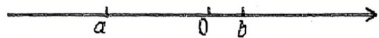

有理数 a，b 在数轴上的位置如图所示，则下列各式成立的是（）

A. b - a > 0

B. -b > 0

C. a > -b

D. -ab < 0

> [!question]- 点击查看答案与解析
> 【答案】B
>
> 【考点】数轴、有理数的大小比较 → [[【初中数学知识点体系-人教版】#1-2 有理数及其大小比较]]
>
> 【解析】
> 由图可知：$b < 0 < a$，且 $|b| > |a|$（b 离原点更远）。
> A 选项：$b - a$，因为 $b < 0$ 且 $a > 0$，所以 $b - a < 0$，故 A 错误；
> B 选项：$b < 0$，所以 $-b > 0$，故 B 正确；
> C 选项：$a > -b$，因为 $-b > 0$ 且 $|b| > |a|$，即 $-b > a$，故 C 错误；
> D 选项：$-ab$，因为 $a > 0$，$b < 0$，所以 $ab < 0$，$-ab > 0$，故 D 错误。
> 故选 B。
>
> 【易错点】不能从数轴上正确判断 $a$、$b$ 的符号和大小关系
