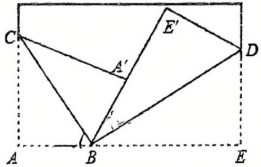

如图所示，将一张长方形纸片斜折过去，使顶点 A 落在 $A'$ 处， $BC$ 为折痕，然后再把 $BE$ 折过去，使之与 $BA'$ 重合，折痕为 $BD$，若 $\angle ABC = 58^\circ$，则求 $\angle E'BD$ 的度数（ ）

A. $29^{\circ}$

B. $32^{\circ}$

C. $58^{\circ}$

D. $64^{\circ}$

> [!question]- 点击查看答案与解析
> 【答案】B
>
> 【考点】折叠问题、角度的计算 → [[【初中数学知识点体系-人教版】#6-3 角]]
>
> 【解析】
> 根据折叠性质：$\angle ABC = \angle A'BC = 58^{\circ}$。
> 又因为 $\angle ABE = 180^{\circ}$（平角），
> 所以 $\angle A'BE = 180^{\circ} - 58^{\circ} - 58^{\circ} = 64^{\circ}$。
> 折叠后 $BE$ 与 $BA'$ 重合，折痕为 $BD$，
> 所以 $\angle E'BD = \angle A'BD = \frac{1}{2} \angle A'BE = \frac{64^{\circ}}{2} = 32^{\circ}$。
> 故选 B。
>
> 【易错点】不理解折叠的性质：折叠前后对应角相等
