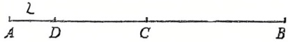

如图， $AB=18$，C 为 AB 的中点，点 D 在线段 AC 上，且 AD:CB=1:3，则 DB 的长度是（）

A. 8

B. 10

C. 12

D. 15

> [!question]- 点击查看答案与解析
> 【答案】D
>
> 【考点】线段的中点、比例计算 → [[【初中数学知识点体系-人教版】#6-2 直线、射线、线段]]
>
> 【解析】
> $AB = 18$，C 为 AB 中点，则 $AC = CB = 9$。
> $AD : CB = 1 : 3$，即 $AD : 9 = 1 : 3$，所以 $AD = 3$。
> $DB = AB - AD = 18 - 3 = 15$。
> 故选 D。
>
> 【易错点】比例关系理解错误，将 $AD:CB$ 误认为 $AD:AC$
