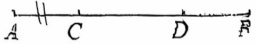

如图，点 C，D 在线段 AB 上，AC=BD，若 AD=8cm，则 BC=\_\_\_cm.

> [!question]- 点击查看答案与解析
> 【答案】$8$
>
> 【考点】线段的等量关系 → [[【初中数学知识点体系-人教版】#6-2 直线、射线、线段]]
>
> 【解析】
> $AD = AC + CD$，$BC = BD + CD$。
> 因为 $AC = BD$，所以 $AD = BC$。
> 已知 $AD = 8\text{ cm}$，所以 $BC = 8\text{ cm}$。
>
> 【易错点】未利用 $AC = BD$ 推导 $AD = BC$ 的等量关系
