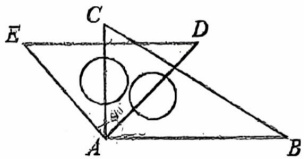

当 $k =$ \_\_\_ 时，多项式 $x^2 + (k - 1)xy - 3y^2 - 2xy - 5$ 中不含 xy 项。

> [!question]- 点击查看答案与解析
> 【答案】$3$
>
> 【考点】多项式的概念 → [[【初中数学知识点体系-人教版】#4-1 整式]]
>
> 【解析】
> 多项式中含 $xy$ 的项为：$(k - 1)xy - 2xy = (k - 1 - 2)xy = (k - 3)xy$。
> 要使多项式中不含 $xy$ 项，则 $k - 3 = 0$，解得 $k = 3$。
>
> 【易错点】合并同类项时系数计算错误
