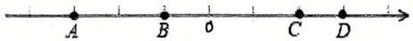

如图，数轴的单位长度为 1.

(1) 如果点 A，D 表示的数互为相反数，那么点 B 表示的数是多少？

(2) 如果点 B，D 表示的数互为相反数，那么图中表示的四个点中，哪一点表示的数的绝对值最大？为什么？

(3) 当点 B 为原点时，若存在一点 M 到 A 的距离是点 M 到 D 的距离的 2 倍，则点 M 所表示的数是\_\_\_

> [!question]- 点击查看答案与解析
> 【答案】(1) $-1$；(2) 点 A，理由见解析；(3) $2$ 或 $10$
>
> 【考点】数轴、相反数、绝对值 → [[【初中数学知识点体系-人教版】#1-2 有理数及其大小比较]]
>
> 【解析】
> (1) 从图中可知，A、B、C、D 从左到右排列，相邻点之间各隔 2 格。
> A、D 互为相反数，A 与 D 之间有 6 格，设 A 表示 $a$，D 表示 $-a$，
> 则 $-a - a = 6$，$-2a = 6$，$a = -3$。
> 所以 A 表示 $-3$，D 表示 $3$。
> B 在 A 右侧 2 格，B 表示 $-3 + 2 = -1$。
> (2) 如果 B、D 互为相反数，设 B 为 $b$，D 为 $-b$。
> B 到 D 有 4 格，$-b - b = 4$，$b = -2$。
> 所以 B 为 $-2$，D 为 $2$。
> A 在 B 左侧 2 格，A 为 $-4$。
> C 在 B 右侧 2 格，C 为 $0$。
> 四个点：A（$-4$）、B（$-2$）、C（$0$）、D（$2$）。
> $|A| = 4$，$|B| = 2$，$|C| = 0$，$|D| = 2$。
> 绝对值最大的是点 A。
> (3) 当 B 为原点时，B 表示 $0$。
> A 在 B 左侧 2 格，A 为 $-2$。
> D 在 B 右侧 4 格，D 为 $4$。
> 设 M 表示 $m$，M 到 A 的距离是 M 到 D 的距离的 2 倍：
> $|m - (-2)| = 2|m - 4|$
> $|m + 2| = 2|m - 4|$
> 分情况讨论：
> 当 $m < -2$ 时：$-(m + 2) = 2(4 - m)$，$-m - 2 = 8 - 2m$，$m = 10$（不满足 $m < -2$，舍去）；
> 当 $-2 \leq m < 4$ 时：$m + 2 = 2(4 - m)$，$m + 2 = 8 - 2m$，$3m = 6$，$m = 2$（满足）；
> 当 $m \geq 4$ 时：$m + 2 = 2(m - 4)$，$m + 2 = 2m - 8$，$m = 10$（满足）。
> 所以 M 表示的数是 $2$ 或 $10$。
>
> 【易错点】(1) 不能正确从数轴上判断各点的位置关系；(3) 绝对值方程未分类讨论导致漏解
