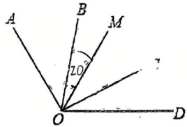

如图所示，∠AOB：∠BOC：∠COD=4：5：3，OM平分∠AOD，∠BOM=20°，求∠AOD和∠MOC.

> [!question]- 点击查看答案与解析
> 【答案】$\angle AOD = 120^{\circ}$，$\angle MOC = 30^{\circ}$
>
> 【考点】角平分线、角度的计算 → [[【初中数学知识点体系-人教版】#6-3 角]]
>
> 【解析】
> 设 $\angle AOB = 4x$，$\angle BOC = 5x$，$\angle COD = 3x$。
> 则 $\angle AOD = 4x + 5x + 3x = 12x$。
> OM 平分 $\angle AOD$，所以 $\angle AOM = \angle MOD = 6x$。
> $\angle BOM = \angle AOM - \angle AOB = 6x - 4x = 2x$。
> 已知 $\angle BOM = 20^{\circ}$，所以 $2x = 20^{\circ}$，$x = 10^{\circ}$。
> $\angle AOD = 12x = 120^{\circ}$。
> $\angle MOC = \angle MOD - \angle COD = 6x - 3x = 3x = 30^{\circ}$。
>
> 【易错点】设未知数表示角度时关系搞错；角平分线的性质运用错误
