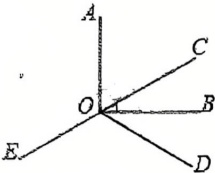

如图，O 是直线 CE 上一点，以 O 为顶点作 $\angle AOB = 90^\circ$，且 OA，OB 位于直线 CE 两侧，OB 平分 $\angle COD$.

(1) ①当$\angle AOC=50^{\circ}$时，求$\angle DOE$的度数：

②当$\angle AOC=70^{\circ}$时，则$\angle DOE$的度数为\_\_\_.

（2）通过（1）的计算，请你猜想 $\angle AOC$ 和 $\angle DOE$ 的数量关系，并说明理由.

> [!question]- 点击查看答案与解析
> 【答案】(1) ① $100^{\circ}$；② $140^{\circ}$；(2) $\angle DOE = 2\angle AOC$
>
> 【考点】角平分线、角度的计算 → [[【初中数学知识点体系-人教版】#6-3 角]]
>
> 【解析】
> (1) ① $\angle AOB = 90^{\circ}$，$\angle AOC = 50^{\circ}$，
> 所以 $\angle BOC = 90^{\circ} - 50^{\circ} = 40^{\circ}$。
> OB 平分 $\angle COD$，所以 $\angle BOD = \angle BOC = 40^{\circ}$。
> O 在直线 CE 上，$\angle COE = 180^{\circ}$，
> $\angle DOE = 180^{\circ} - \angle COD = 180^{\circ} - (\angle BOC + \angle BOD) = 180^{\circ} - 80^{\circ} = 100^{\circ}$。
> ② $\angle AOC = 70^{\circ}$，
> $\angle BOC = 90^{\circ} - 70^{\circ} = 20^{\circ}$，
> $\angle COD = 2 \times 20^{\circ} = 40^{\circ}$，
> $\angle DOE = 180^{\circ} - 40^{\circ} = 140^{\circ}$。
> (2) 猜想：$\angle DOE = 2\angle AOC$。
> 理由：设 $\angle AOC = \alpha$，则 $\angle BOC = 90^{\circ} - \alpha$。
> OB 平分 $\angle COD$，所以 $\angle COD = 2\angle BOC = 2(90^{\circ} - \alpha) = 180^{\circ} - 2\alpha$。
> $\angle DOE = 180^{\circ} - \angle COD = 180^{\circ} - (180^{\circ} - 2\alpha) = 2\alpha = 2\angle AOC$。
>
> 【易错点】不能利用角平分线和平角的性质建立角度关系
